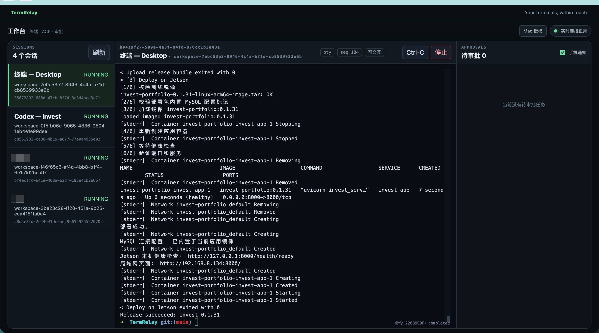

# TermRelay

**用手机或浏览器，继续操作电脑上的终端和 AI 编程助手。**

比如：你在 Mac 上让 Codex 写代码，离开电脑后，用手机查看进度、回复问题、批准操作，不用一直守在电脑前。

任务仍在你的电脑上运行，TermRelay 负责把操作界面带到浏览器。

## 能做什么

- 远程使用终端，输入命令、查看输出。
- 与 Codex、GitHub Copilot CLI、DeepSeek DSH 对话。
- 在手机上处理 AI 的审批和提问，可选开启 iPhone 推送。

主要支持 Mac；[Linux 版本](apps/linux/README.md)还在完善中，目前支持 Shell 和 Codex。

## 看起来是什么样



## 怎么用

你需要一个运行中的服务端，以及电脑上的 TermRelay 客户端。浏览器和手机通过服务端访问电脑上的会话。

### 在 Mac 本机试用

准备 macOS 14+、完整 Xcode 16+（含 Metal 工具链）、Node.js 22+、pnpm（版本见 `package.json`）和 Docker Desktop。要使用哪个 AI 助手，就先安装并配置好对应的 CLI。

```bash
git clone https://github.com/wangweijia/TermRelay.git
cd TermRelay
pnpm install

# 启动服务端，保持运行
docker compose -f deploy/server/compose.dev.yaml up --build
```

另开一个终端，启动 Mac 客户端：

```bash
swift run --package-path apps/mac TermRelay
```

在客户端新建会话，然后打开 **http://localhost:3007**，就能在浏览器中操作。

手机页面是 `/mobile`。在外网使用前，请按下面的部署文档配置访问保护，**不要把本地开发服务直接暴露到公网**。

## 详细说明

- [服务端部署](docs/SERVER_RELEASE.md) · [公网访问配置](docs/CLOUDFLARE_ACCESS.md) · [Mac 公网配对](docs/CLOUDFLARE_MAC_CLIENT_AUTH.md)
- [Linux 安装与使用](apps/linux/README.md)
- [让其他程序调用电脑上的 AI 助手](docs/AI_SERVICE_SETUP.md)
- [开发环境](docs/ENVIRONMENTS.md) · [项目架构](docs/ARCHITECTURE.md)

目前是适合个人试用的早期项目，尚未指定开源许可证。
