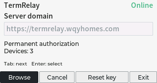

# TermRelay CardputerZero

基于用户提供的 CardputerZero Application Template 初始化的原生客户端项目。
技术方案见 [CardputerZero App 设计](../../docs/CARDPUTERZERO_APP_DESIGN.md)。

## 当前状态

已导入 LVGL 模板及其演示界面、桌面模拟器、Linux 显示/输入适配和构建预设。
已实现授权连接首个闭环：原生域名输入、后台配对、Web 设置页选择执行设备后批准、永久凭据保存与恢复、共享公网 WSS 连接及在线撤销。
本轮按用户授权同步修改 Server、Contracts 和 Web；Mac / Linux Agent 实现未改，不连接真实 AI Provider。
已接入授权设备和会话摘要的分页浏览，以及 ACP 聊天历史、实时消息、发送、审批和问答，详情见下文。PTY 会话目前仅显示元数据。

2026-11-05 验证记录：macOS Apple Silicon Debug 构建通过，产物为 Mach-O arm64；
安装暂存到本项目 `build/` 后，启动器、唯一命名图标、配置文件及默认不安装服务的检查通过。
LVGL v9.5.0 已下载到忽略的 `.cache/vendor/`，本地配置使用该源码完成，无需重复下载。
未启动模拟器，未做截图或交互验收，未验证 Linux ARM64、实机及 `.deb` 包。
本轮新增验证：原生 Debug 构建和 1 个 CTest（HTTPS 地址、输入映射及私有存储）通过；C++ 探针与临时 Nest HTTP/WSS 服务完成配对、授权、重启恢复与在线撤销。集成测试使用内存仓库，不代表真实 MySQL 迁移或公网 TLS 已验收。

## 模板依据

- 上游：[CardputerZero/Template](https://github.com/CardputerZero/Template)。
- 本次来源：用户提供的本地 `Template-main` 解压目录，模板版本 0.2.1。
- 上游配套工具：[CardputerZero/AppBuilder](https://github.com/CardputerZero/AppBuilder)。
- 本地源码确认：C++17、CMake 3.31+、LVGL v9.5.0、SDL2、FreeType、libpng、JPEG、fmt 和 zlib。README 徽标中的 SDL3 不是该源码的实际依赖。
- 模板有 MIT 许可证，保留原始声明及字体许可清单；这不表示 TermRelay 整个仓库已指定 MIT 许可证。
- 解压目录没有 Git 元数据，不能据此确定上游 commit；不虚构 commit 或下载日期。

LVGL 由 CMake FetchContent 按 v9.5.0 获取，首次配置需要网络。
可使用标准 CMake 参数 `-DFETCHCONTENT_SOURCE_DIR_LVGL=/absolute/path/to/lvgl` 指定已下载的同版本源码。
未导入上游代理指令、截图、部署脚本或 AppStore 占位发布信息。

## 目录

```text
src/             授权启动页、connection 网络状态机、模板 UI 和平台适配
tests/           无 GUI 的授权存储/输入测试和原生连接探针
assets/          模拟器外壳、字体、图标和音效，保留模板资源
config/          应用默认配置
cmake/           设备工具链和构建辅助
packaging/       安装、desktop 入口和可选 systemd 模板
CMakeLists.txt   应用目标和依赖
CMakePresets.json 桌面及设备构建预设
app-builder.json 私有构建元数据，不配置 AppStore 发布
```

## 换电脑快速开始

优先使用仓库中已经初始化好的本目录，不必重新下载模板，也不必安装 AppBuilder CLI。
先把包含本目录的仓库版本同步到新电脑；仅克隆远端不会带上尚未提交或推送的本地文件。
这个原生应用单独编译不依赖 `pnpm install`，不需要提供 AI 凭据；真实授权需要先部署支持控制端角色的 Server / Web 并应用迁移。

### 1. 检查构建环境

需要 CMake 3.31+、Ninja、C++17 编译器、SDL2、FreeType、libpng、JPEG、fmt、zlib、libcurl 8.4+（必须编译启用 ws/wss）及 nlohmann-json 3.11+。
macOS 先检查 Apple 工具链与已有依赖：

```sh
xcode-select -p
cmake --version
ninja --version
clang++ --version
pkg-config --modversion sdl2 freetype2 libpng libjpeg fmt zlib
```

缺少 Apple 命令行工具时由用户运行 `xcode-select --install`。此应用的桌面构建不要求完整 Xcode；
仓库 Mac App 的完整 Xcode / Metal 要求是另一件事。
已有 Homebrew 时，从下面列表中只安装本机缺少的项目：

```sh
HTTP_PROXY=http://127.0.0.1:7890 HTTPS_PROXY=http://127.0.0.1:7890 \
ALL_PROXY=http://127.0.0.1:7890 \
brew install cmake ninja pkgconf sdl2 freetype libpng jpeg fmt zlib curl nlohmann-json
```

代理命令仅用于本机已启动 `7890` HTTP 代理时；不会修改 shell 全局代理配置。macOS 系统 curl 的版本号不足以证明支持 WebSocket，检查 Homebrew 版本：

```sh
"$(brew --prefix curl)/bin/curl" --version
```

`Protocols` 必须包含 `ws wss`。本次使用 curl 8.23.0、nlohmann-json 3.12.0；其余电脑和目标设备需自行确认。

不需要为桌面预览预装 ARM 交叉工具链、BSP、`dpkg` 或发布工具。
Apple Silicon 使用 arm64 Homebrew 与依赖；不要混用 Rosetta 的 x86_64 库。
若 CMake 找不到已安装的 Homebrew 依赖，可在配置命令后追加 `-DCMAKE_PREFIX_PATH="$(brew --prefix)"`。

### 2. 配置和编译

以下命令从 TermRelay 仓库根目录开始执行：

```sh
cd apps/cardputerzero
cmake --list-presets
cmake --preset darwin-arm64 -DCURL_ROOT="$(brew --prefix curl)"
cmake --build --preset darwin-arm64-dbg --parallel 4
```

首次配置会通过 Git 获取 LVGL v9.5.0，需要网络；失败时改用下一节的源码包方式。
Debug 程序位于 `build/darwin-arm64/Debug/termrelay-cardputerzero`。
需要打开授权界面时，可手动运行：

```sh
./build/darwin-arm64/Debug/termrelay-cardputerzero
```

这会打开授权窗口，本轮未自动运行 GUI 或做视觉验收。首次授权步骤见下文；不要用模板演示截图作为新界面的验收证据。

其他宿主机预设：

| 环境 | 配置 | Debug 构建 | 验证状态 |
| --- | --- | --- | --- |
| Apple Silicon Mac | `darwin-arm64` | `darwin-arm64-dbg` | 本次已编译通过 |
| Intel Mac | `darwin-x86-64` | `darwin-x86-64-dbg` | 模板保留，未验证 |
| Linux x86_64 | `linux-x86-64` | `linux-x86-64-dbg` | 模板保留，未验证 |

Linux 桌面还需要启用 WebSocket 的 libcurl 开发包及 `nlohmann-json3-dev`，不能只检查系统 `curl` 命令版本。
其余包包括编译器、CMake、Ninja、pkg-config、SDL2、FreeType、PNG、JPEG、fmt 和 zlib 的开发包。
Debian/Ubuntu 可对应 `build-essential`、`cmake`、`ninja-build`、`pkg-config`、`libsdl2-dev`、
`libfreetype-dev`、`libpng-dev`、`libjpeg-dev`、`libfmt-dev`、`zlib1g-dev`，但先确认发行版 CMake 达到 3.31。
不能假设系统默认 CMake 足够新；本文不声称 Linux 或 Windows 已完成验证。

### 3. Git 下载失败时使用固定版本源码包

本次遇到 GitHub API 限流、页面抓取失败和 Git `Broken pipe`；Git 失败不代表模板不存在。
下载依赖不需要 GitHub API、PAT 或 GitHub 登录。以下命令在本应用目录执行：

```sh
mkdir -p .cache/vendor
curl --fail --location --connect-timeout 10 --max-time 180 \
	--output .cache/vendor/lvgl-v9.5.0.tar.gz \
	https://codeload.github.com/lvgl/lvgl/tar.gz/refs/tags/v9.5.0
tar -xzf .cache/vendor/lvgl-v9.5.0.tar.gz -C .cache/vendor
cmake --preset darwin-arm64 \
	-DCURL_ROOT="$(brew --prefix curl)" \
	-DFETCHCONTENT_SOURCE_DIR_LVGL="$PWD/.cache/vendor/lvgl-9.5.0" \
	-DFETCHCONTENT_FULLY_DISCONNECTED=ON
cmake --build --preset darwin-arm64-dbg --parallel 4
```

本次实际使用这条路径构建成功。压缩包约 97 MiB，解压与编译还需额外空间；
出现下载 100% 并不代表解压、配置和构建全部结束，需看最终命令退出码和构建结果。
其他架构把配置/构建预设替换为对应名称，LVGL 源码路径不变。

完全离线时，可以从另一台机器传输同版本源码包或已解压的源码，再传入该参数。
不要在 LVGL 源码尚未存在时启用 `FETCHCONTENT_FULLY_DISCONNECTED=ON`，否则 CMake 会直接报错。
该参数只禁止 FetchContent 联网，不代表设备工具链也不会下载 BSP。

### 4. 配置 VS Code 头文件解析

仓库级设置使用 `C_Cpp.default.compileCommands` 指向编译数据库。
从仓库根目录打开 VS Code、并完成配置后，Apple Silicon 路径为：

```json
{
	"C_Cpp.default.compileCommands": "${workspaceFolder}/apps/cardputerzero/build/darwin-arm64/compile_commands.json"
}
```

这是 VS Code C/C++ 扩展的设置。构建预设会生成数据库，其中包含真实头文件路径和 `USE_DESKTOP=1`。
若换电脑后仓库级本地设置未同步，请在 VS Code 设置中配置相同字段；不要假定被忽略的本地配置会随 Git 迁移。
Intel Mac / Linux 替换路径中的预设名；若仅打开本应用目录，则去掉 `apps/cardputerzero/` 前缀。
使用 clangd 等其他扩展时，应配置其自己的编译数据库路径，不能指望 `C_Cpp` 设置生效。

本次遇到：编译成功，但编辑器提示找不到 `xf86drmMode.h`。原因是编辑器缺失桌面宏，
把 `src/config/lv_conf.h` 解析进 Linux 分支；使用正确数据库后诊断消失。
不要为修复这个桌面误报安装 Linux DRM 依赖，也不要删除平台条件编译代码。

### 5. 检查安装布局，不安装到系统

需要复现初始化时的安装检查，可在本应用目录运行：

```sh
DESTDIR="$PWD/build/darwin-arm64/stage" \
	cmake --install build/darwin-arm64 --config Debug --prefix /usr
```

只写入项目 `build/darwin-arm64/stage/`，不需要 sudo。
应能看到 `usr/bin/termrelay-cardputerzero`、`etc/termrelay-cardputerzero.conf`、
`usr/share/APPLaunch/applications/termrelay-cardputerzero.desktop` 和唯一命名的图标。
默认不安装 systemd 服务。不要漏掉 `DESTDIR` 后把调试程序直接安装进系统目录。

### 6. 迁移和重新配置

- 同步源代码、资源、配置、构建文件、打包文件和许可证；不依赖原电脑桌面的 Template-main 目录。
- `build/` 和 `.cache/` 被忽略，不随 Git 同步；离线使用时单独传输 LVGL 源码包即可。
- 不复制旧电脑的 CMakeCache 或整个 build 目录：其中含绝对路径、编译器、架构及依赖位置。
- 本次传入的 `FETCHCONTENT_SOURCE_DIR_LVGL` 会保存在当前构建缓存中，不是跨电脑可用的路径。
- 路径或架构改变后，在本应用目录重新配置；需要重置缓存时使用 `cmake --fresh --preset darwin-arm64`，并按需重新传入本地 LVGL 路径及离线选项。
- 清理缓存或更换预设不会改变源代码；不要通过重置 Git 工作区来解决 CMake 缓存问题。
- 新电脑成功配置与链接，只说明宿主机目标可编译，不表示设备可运行或业务功能完成。

## 在 Cardputer Zero 上原生编译

设备使用 Debian 13 ARM64。原生构建使用系统开发库，无需交叉编译 BSP，也不需要 SDL 或桌面会话。
将本应用目录和固定版本 LVGL 源码传到设备后，在设备的应用目录执行：

```sh
sudo apt-get install --no-install-recommends \
	build-essential cmake ninja-build pkg-config libfreetype-dev libpng-dev \
	libjpeg-dev libfmt-dev zlib1g-dev libcurl4-openssl-dev nlohmann-json3-dev
cmake --preset cp0-native \
	-DFETCHCONTENT_SOURCE_DIR_LVGL="$PWD/.cache/vendor/lvgl-9.5.0" \
	-DFETCHCONTENT_FULLY_DISCONNECTED=ON \
	-DCMAKE_INSTALL_PREFIX=/usr
cmake --build --preset cp0-native-dbg --parallel 1
ctest --test-dir build/cp0-native -C Debug --output-on-failure
sudo cmake --install build/cp0-native --config Debug --prefix /usr
```

这里的离线配置要求 `.cache/vendor/lvgl-9.5.0` 已存在，准备方法见上文。
设备可用物理内存约 352 MiB，原生预设使用单任务和 `-O0 -g1`，保留行号 / 函数信息，减少完整调试符号带来的换页。
需要检查局部变量时可覆盖 `CMAKE_CXX_FLAGS_DEBUG`，或使用宿主机交叉编译；不复制其他电脑的 CMakeCache。
设备预设绑定 `/dev/input/by-path/platform-3f804000.i2c-event`，对应板载 `tca8418c` 键盘，
避免自动扫描时把 HDMI / 红外输入设备也绑定进来。其他硬件可用 `-DAPP_KEY_INPUT_DEVICE=...` 覆盖。
显示默认使用 `/dev/fb0`；实机为 320×170、16 位 RGB565，LVGL 根据帧缓冲格式设置输出。

安装后从 M5 启动器选择 **TermRelay**，以普通用户运行；该用户需具有 `video`、`input` 组权限。
不要与启动器同时手工启动另一个直接绘制帧缓冲的实例。默认不安装常驻服务，也不恢复或启动 Linux 桌面。
这一步是设备调试安装，不代表 `.deb` 发布包或 AppStore 发布已验收。

### 实机调试记录（2026-11-15）

已在 Cardputer Zero 的 Debian 13 ARM64 上使用 GCC 14.2、CMake 3.31.6、系统 curl 8.14.1 和 LVGL 9.5.0 完成 Debug 构建及安装。
修复了原生构建错误要求 BSP 的问题；设备预设固定板载键盘路径，并采用单任务 / 精简调试符号以减少编译换页。
另修复设备版未设置 LVGL delay 回调而持续忙等的问题：改用线程休眠，保留桌面版 SDL 回调。
修复前运行记录接近占满一个核心；修复后连接页 10 秒采样约为单核的 12.7%，RSS 约 17 MiB，进程无换页。
这是 Debug 连接页的一次采样，不是在线聊天负载或续航测量。

- 设备 CTest 3/3 通过，覆盖私有存储、输入映射、列表及聊天状态。
- 服务端与设备联调测试 9/9 通过（含子测试），覆盖配对、凭据恢复、25 条会话分页、90 秒空闲心跳、心跳超时重连、历史与实时聊天、审批、问答、丢失回执及撤销清理。使用 SSH 转发的本机 HTTP / WS 测试服务与合成会话，没有启动真实 AI 或访问生产数据库。
- 实际帧缓冲截图确认授权页与空域名错误提示正常；通过板载键盘的 evdev 接口注入文字、退格、Tab、Shift+Tab、Enter、短按 / 长按 Esc，确认输入、导航、校验和正常退出。未逐个手按物理按键，也未验收 Fn 层或中文输入法。
- 普通用户 `weijia` 运行，凭据目录 / 文件权限为 0700 / 0600；Noto CJK 字体成功加载，中文内容排版仍需真实会话验收。
- 通过临时用户 unit 调试，退出自动恢复 M5 启动器，没有安装常驻服务或启用 Linux 桌面。已安装 M5 的 TermRelay 入口。



随后已在用户公网服务完成证书校验、Web 授权和 WSS 身份确认，读取到 3 台授权设备及真实 ACP 会话元数据；
关闭并重新启动应用后，使用本机永久凭据自动恢复在线，无需再次批准。
更新前只读探针确认线上服务仅声明 `devices.list` / `sessions.list`，没有声明 `conversation`。
当时 Jetson 运行的 `termrelay/server:0.1.68` 没有掌机聊天模块。随后通过 Release Runner 发布 `0.1.71`，
构建、上传、部署及健康检查成功；掌机无需重新授权即自动重连，真实 ACP 会话进入聊天页，历史同步及中文显示通过实机检查。
此次没有向真实 AI 发送消息，也没有处理真实审批或修改现有授权范围。
发布前检查：Server 测试 218 项中 212 通过、6 项按配置跳过，Web 生产构建通过，Release Runner 的服务端配置校验通过。
本轮仅修改掌机应用和文档，未更改 Contracts / Server / Web；未重跑全仓库 `pnpm check`。

### 小屏焦点修复（2026-11-15）

修复从设备列表返回 `Server domain` 时 Tab 无效的问题：已保存的域名被禁用，LVGL 在重建导航组时没有选中后续按钮；现在组装完成后恢复到第一个可用控件，并保留刷新时的有效焦点。聊天和列表页也统一恢复键盘组。

按钮采用浅灰底，当前选中项为黑底白字，禁用项为淡灰色；输入框选中时使用深色边框。取消外扩光圈、阴影及切换动画，状态改变时完整重绘控件，避免小屏上高亮残缺。连接页直接显示 `F/X up/down / Z/C left/right / Enter: OK` 提示，退出按钮改为 `Exit`，清除本机密钥改为 `Reset key`，仍需二次确认。

F/X 上下切换列表与控件，Z/C 左右切换同一行按钮（兼容大小写及标准方向键），跳过锁定域名、隐藏项和不可用按钮；移动焦点不会触发按钮或勾选答案。长消息与详情聚焦后，F/X 优先滚动阅读，到边界后可继续切换控件。Tab / Shift+Tab 仍按顺序切换，Enter 执行选中项。输入框中的 F/X/Z/C 正常输入文字，标准方向键移动光标，使用 Tab 离开输入框。已有授权时选择 `Browse` 进入设备列表，Esc 返回，长按 Esc 退出。

新增使用真实主题和局部绘制的键盘回归测试，检查焦点恢复、Tab 正反向循环、跳过禁用项、输入文字，以及绘制结果中完整且唯一的选中高亮。设备 CTest 4/4 通过；聊天界面探针也应用同一主题，历史、审批、问答、丢失回执及撤销回归通过。实机已确认在线恢复、返回配置页、Tab / Shift+Tab 高亮切换以及 Enter 进入列表后再次返回；通过 evdev 注入按键，不等同于逐个手按物理按键或 Fn 层验收。

## 本次如何从模板初始化

这部分是初始化复盘，不是每台电脑都要重复的操作。
日常开发直接使用本目录；若将来重新基于上游初始化，应另建目录对照，不能覆盖当前项目代码。

1. 核对本地模板 README、CMake、主入口、预设、包元数据、资源与许可证。确认版本 0.2.1、LVGL v9.5.0、SDL2 和 CMake 3.31+；解压包没有 Git commit，不能伪造版本溯源。
2. 复制源码、资源、配置、CMake 工具链/辅助文件、预设、包元数据与许可证。排除嵌套 Git、缓存、构建产物、上游代理指令、截图和一键部署脚本，不引入其发布流程。
3. 把 CMake 工程名及包名改为 `termrelay-cardputerzero`、版本改为 0.1.0，窗口与页面标题改为 TermRelay；保留原始代码的版权声明。
4. 配置文件统一为 `termrelay-cardputerzero.conf`，同时修改桌面/设备默认路径、XDG 用户配置路径、安装规则及 conffiles，避免只改文件名却漏改运行时读取路径。
5. 将 `template*.png` 改为 `termrelay-cardputerzero*.png`，同步 desktop 图标路径和安装匹配规则。APPLaunch 图标是共享目录，保留模板通用名称会与其他应用冲突；图片内容仍是模板素材，不代表正式品牌图标。
6. 将模板包辅助逻辑和 desktop/systemd/conffiles 模板放到 `packaging/`，修改 CMake include；工具链保留在 `cmake/`。包产物指向根 `dist/termrelay-cardputerzero/`，不是应用局部 dist。
7. 关闭默认 systemd 安装：上游服务没有指定 User，会以 root 运行。本次保留可选模板但默认 OFF；不能直接开启当作正式非 root 服务。
8. 清除 `app-builder.json` 的 AppStore 占位发布信息，保留私有构建元数据；不虚构作者、许可证、产品截图或发布授权。
9. 先验证 `cmake --list-presets`，再配置、编译和项目内暂存安装；检查唯一命名资源、配置路径及未默认安装服务，最后同步实际验证结果。

### 其他已遇到或确认的注意事项

- 上游 README 顶部出现 SDL3 徽标，但源码通过 `find_package(SDL2)` 构建；依赖以源码为准。
- 本次 shell 没有 `rg`。搜索可以回退到编辑器搜索或系统工具，不需要为构建本项目额外安装 ripgrep。
- `git diff --no-index` 用于比较不同文件时可能返回 1；不要把它与独立检查用 `&&` 连接后，误以为后续检查也执行了。应分别读取退出码与验证输出。
- 不要把编辑器“无诊断”、编译通过、安装暂存通过、GUI 验收通过和实机通过混为一谈；这些是不同检查。
- 模板初始化阶段没有单测；授权阶段已新增 CTest，不依赖外部 C++ 测试框架。不要将两阶段验证混淆。
- AppBuilder 是配套构建/发布工具，不是需要嵌入 App 的运行时；初次本地开发不要求登录 GitHub 或公开发布仓库。

## 授权连接

1. Server 按 [环境约定](../../docs/ENVIRONMENTS.md) 选择正确数据库，构建后应用 `1793836800000-controller-auth` 显式迁移，再部署 Server / Web。本轮没有实际执行迁移，也没有使用生产数据库。
2. 沿用 Mac 的同一公网域名和三个精确 Bypass 路径：`/api/client-pairings`、`/api/client-pairings/token`、`/ws/client-public`。不要 Bypass Web 管理接口。
3. 原生界面填写服务域名（自动补 `https://`），选择 `Connect`。不显示短码、二维码或倒计时。
4. 自行登录现有 Web 的“配置”，在“掌机授权”的待授权列表核对安装 ID、版本和申请时间，选择允许访问的执行设备后批准。
5. 掌机显示 `Online` 与授权设备数量。普通断网自动重连；退出后保留凭据，重启无需再次批准。
6. Web 的“删除授权”先持久化撤销，再通知并关闭在线掌机（4003）。掌机清除本机密钥并停止重连；重新连接需要再次批准。

在线后每 25 秒通过现有 WSS 发送 `controller.me.get`，收到有效的 `controller.connected` 响应才更新存活时间；连续 75 秒未确认则按原有退避策略重连。初次身份确认仍有 10 秒超时。应用层心跳不依赖 libcurl 自动处理的 Ping/Pong，正常空闲不会因此误触发重连。

`Cancel` 在待授权时尝试取消申请，在线时仅断开本次连接；长按 Esc 退出。关闭进程或网络中断时未确认取消的申请会自动过期，不会生成永久凭据。
`Reset key` 需要再次确认，只移除本机副本，不撤销 Web 上的授权；旧授权需在 Web 手动删除。已有凭据时服务地址锁定，清除后才能更换地址，绝不向新地址发送旧凭据。

凭据和随机 installation ID 保存在 `$XDG_STATE_HOME/termrelay-cardputerzero/authorization.json`，未设置时为 `$HOME/.local/state/termrelay-cardputerzero/authorization.json`。目录 0700、文件 0600、原子替换；拒绝不安全权限或符号链接。该文件含长期密钥，不要复制到日志、截图、Git 或排障材料中。服务端仅保存摘要。

键盘目前按 Linux 标准 US evdev 字母、数字、标点、Shift、编辑和 Tab / Shift+Tab 焦点导航映射；尚未在实机核对 Fn 层、布局或输入设备权限。中文 UI、中文输入和全部业务界面不属于此次授权连接验收。

授权接口依赖现有 Access / Tunnel 保护管理面，未新增应用级 Access JWT 校验；不得把源站管理接口直接暴露到公网。当前只支持单 Server 实例的即时撤销。待授权最多返回最近 100 条，凭据列表最多 500 条；游标分页、权限缩减和多副本撤销仍待后续完善。

### 只读设备与会话列表

授权连接后自动进入设备列表，使用 F/X 上下、Z/C 左右或 Tab / Shift+Tab 移动焦点、Enter 选择。选择设备进入会话列表，选择会话查看完整元数据；底部提供 `Back`、`Refresh`、`Next page`，Esc 逐层返回，长按 Esc 退出。返回连接页后通过 `Browse` 再次进入列表。会话信息可聚焦内容区并用方向键滚动。

掌机隐藏状态为 `offline` 的设备；原始记录及授权保留，刷新列表时重新上线的设备会显示。连接页提示 `Online devices only`，不再把包含离线记录的授权总数显示成设备数量。过滤同时作用于显示列表和选中索引，避免隐藏条目后选择错设备；分页游标沿用完整服务端页，整页均离线时提示使用 `Next page` 继续查找，末页则显示 `No online devices.`。

列表复用现有 WSS，新增 `controller.devices.list` / `controller.sessions.list` 查询和对应 `.listed` 响应；响应的 `relatedMessageId` 关联请求。连接身份中的 `capabilities` 明确声明列表支持，旧 Server 不声明时提示升级。信封携带掌机 installation ID；目标执行设备 ID 位于会话查询 payload，Server 校验 `sessions.read` 和设备授权。

每页最多 20 条，按不可变 ID 升序，以最后一项 ID 为下一页游标；名称和状态更新不会改变分页顺序。翻页期间新出现且 ID 早于游标的会话需通过 `Refresh` 从首页查看，列表并非冻结快照。Server 在数据库中按设备过滤并排除软删除会话。当前没有上一页历史栈，`Refresh` 返回首页。

原生只保留一页设备和一页会话摘要，单条响应上限 128 KiB、查询超时 10 秒、最多一个在途查询和一个合并后的待发请求；迟到旧响应不会覆盖新请求的页面。列表操作不会推迟 25 秒应用层心跳。Server 每连接每 10 秒最多 30 个消息、最多两个并发查询，发送缓冲超过 256 KiB 或单响应超限会关闭连接。

断网时保留进程内已读页面，显示 `Offline (cache)`；重连后重新查询最后一页。退出不持久化摘要；Web 撤销授权、清除本机凭据或更换地址时清空缓存。ACP 会话现在可以进入聊天页；PTY 会话仍显示元数据。

2026-11-05 本轮验证：macOS arm64 Debug 构建及两个 CTest 通过；原生探针读取 25 个会话的两页摘要，验证恢复凭据和撤销后缓存清空。新增服务端授权隔离、稳定游标、隐藏会话过滤、撤销竞态、慢连接和并发测试。未运行 GUI，中文显示、焦点和 320×170 截图仍待验收。

当前机器缺少部分 Homebrew 依赖，macOS 27 无对应默认 bottle。本轮在临时目录使用 CMake 4.4.4、Ninja、fmt 10.1.1、nlohmann-json 3.12.0 和启用 OpenSSL / WS / WSS 的 curl 8.17.0，复用已有 SDL2 / 字体 / 图片库；与此前 Homebrew curl 8.23.0 的环境不同。临时绝对路径不属于发布配置，不复制 CMakeCache 到其他电脑。

跨包 `pnpm check` 已执行：Contracts、TypeScript 和 Linux 检查通过；Mac 150 项中 6 项跳过，聊天滚动测试 `testLazyTranscriptKeepsVisibleTextAfterLargeAnswerShrinksWhileReading` 的空视口断言失败，单独重跑同样失败。本次未修改 Mac，修改前保留的检查日志也有同一失败，完整仓库 gate 未通过。

### 聊天、审批与问答（2026-11-10）

在设备 → 会话列表选择 ACP 会话进入聊天。`Write` 编辑消息，Enter 换行，Tab 离开输入框后选择 `Send` 发送。AI 运行期间可以编辑草稿，`Send` 保持禁用，并显示 `AI running`；收到 `turn.completed` 后才恢复发送。空白消息、离线、同步中、只读会话、发送回执等待中或结果未知时也不能发送。命令完成回执不代表 AI 轮次完成；只有发送完成回执确认后才清空对应草稿。`Actions` 可读取更早历史、回到最新消息、查看审批 / 问答、查询最后一条命令结果、重新同步及停止当前轮次。实体键盘支持 F/X 上下、Z/C 左右，以及 Tab / Shift+Tab / Enter 和 Esc 导航（输入框内保留文字输入）；中文输入法仍待实机验证。

聊天复用 `/ws/client-public` 的 `conversation` capability，通过 `controller.conversation` / `controller.conversation.result` 交互。Server 建立单会话订阅后返回同步边界和最近 20 条事件，`ready` 后按连续 seq 补齐实时事件；检测缺口或同步缓冲溢出时重新同步。审批 / 问答单独分页查询，不能仅凭最近历史推断当前待处理请求。

掌机仅提供 `allowOnce`、拒绝、取消审批；允许操作要求完整加载并阅读到末尾，再次确认。大事件通过 base64 分块顺序读取，Server 仅在完整读取后发放审批 / 问答 review token；发送前再次检查权限、设备归属、请求是否仍有效及自动审批状态。超过设备预算的请求明确转到 Web 处理。问答支持单选、多选（上游请求声明时）、其他答案和私密输入；每道题必须回答。

原生事件窗口最多 128 条 / 256 KiB，消息最多 64 条 / 256 KiB，单条显示最多 64 KiB，完整事件读取上限 256 KiB；超限显示提示。历史翻页保留更早窗口，返回最新会重新同步。正文、草稿和答案只在内存中保存（最多 8 份消息草稿、16 份问答草稿）；关闭进程后不恢复，不实现 SQLite 历史缓存。

所有写命令复用现有 CommandRelay 和回执仓库。发送前在私有凭据文件保存最多 32 条命令 ID、会话 ID、命令类型，不保存待发送正文或答案。断线 / 超时后结果标记未知，重新同步后查询回执，绝不自动重放。未知结果会阻止再次提交，可手动查询，或明确确认后发起一条新命令。撤销授权或清除本机凭据同时清空正文缓存和回执元数据。

新增纯 C++ 状态测试、原生 WSS 回环探针和无窗口 LVGL 界面探针，覆盖历史分页、实时回复、大小审批、问答、发送中防重复、回执丢失重连及撤销清理。不启动真实 AI Provider。界面探针使用软件显示器，不代表中文字体、实体按键或设备视觉验收。

本轮 Server 全套 216 项中 210 通过、6 跳过；显式启用两种聊天探针后均通过，新协议 / 权限 / 共享依赖实例测试通过，Web build 与最新全包 typecheck 通过。原生通过 clang++ 重新编译全部 29 个应用翻译单元并链接可执行程序，复用已有 LVGL 静态库；当前临时 CMake 工具已清除且重新下载未完成，本轮没有重新运行 CMake 配置 / CTest，纯 C++ 测试直接编译运行。完整 `pnpm check` 仍因上文记录的既有 Mac 滚动测试失败，未标为通过。

### 无 GUI 验证

在仓库根目录，完成原生 Debug 构建后：

```sh
ctest --test-dir apps/cardputerzero/build/darwin-arm64 -C Debug --output-on-failure
pnpm --filter @termrelay/server build
TERMRELAY_NATIVE_PROBE="$PWD/apps/cardputerzero/build/darwin-arm64/Debug/authorization_probe" \
	node --test apps/server/dist/client-auth/controller-auth.service.spec.js
TERMRELAY_CONVERSATION_PROBE="$PWD/apps/cardputerzero/build/darwin-arm64/Debug/conversation_probe" \
TERMRELAY_CONVERSATION_UI_PROBE="$PWD/apps/cardputerzero/build/darwin-arm64/Debug/conversation_ui_probe" \
	node --test apps/server/dist/client-auth/controller-conversation.native.spec.js
pnpm --filter @termrelay/web build
pnpm check
```

探针仅在测试构建中生成，显式允许数字回环地址的 HTTP / WS；正式 App 默认只接受 HTTPS / WSS。测试启动临时回环服务，不访问真实数据库、Cloudflare 或 AI Provider。不设置 `TERMRELAY_NATIVE_PROBE` 时，Server 普通测试会跳过 C++ 集成检查。

启用原生探针时，还会并行验证两个长连接场景：健康空闲 90 秒不重连，以及服务端继续 Ping/Pong、但停止回答应用层心跳时触发超时重连。这组检查约需 90 秒。

发布前仍需真实 MySQL 迁移、公网 TLS / Access、320×170 视觉与键盘交互、实机 ABI、Linux 交叉编译和设备依赖打包验收。模板 Debian 依赖清单尚未适配并验证设备上的 WebSocket libcurl，不可直接发布 `.deb`。

## 在开发电脑编译，在掌机运行

Apple Silicon Mac 可使用本机 Docker Desktop 的 Linux ARM64 容器编译设备程序，无需让掌机承担编译负载。构建容器使用 Debian 13，与当前掌机系统匹配；这是 Linux 容器内的 ARM64 原生构建，不使用旧 BSP 交叉编译预设。Intel 电脑需要 Docker 的 ARM64 模拟支持，速度未验证。

在仓库根目录运行：

```sh
pnpm cardputerzero:build
# 需要更完整的调试行为时：
pnpm cardputerzero:build Debug
```

默认 `RelWithDebInfo` 使用 `-O2 -g1`，保留调试符号并启用优化；也支持 `Release`。默认并行 4 任务，可通过 `CARDPUTER_BUILD_JOBS=8` 调整。首次准备镜像需要联网安装编译依赖并下载 LVGL 9.5.0；之后编译和 CTest 在禁网容器内运行，镜像和 `build/cp0-container/` 缓存可复用。容器只挂载本应用目录，不需要掌机授权文件或 SSH 凭据。

当前网络访问 Debian 默认 CDN 的大索引会超时，构建镜像默认使用清华 Debian 镜像，仍使用 Debian 官方签名验证索引与软件包。可设 `CARDPUTER_DEBIAN_MIRROR=http://deb.debian.org` 切回官方 CDN。

产物为 `apps/cardputerzero/build/cp0-container/RelWithDebInfo/termrelay-cardputerzero`，同目录包含测试和探针可执行文件。编辑源码后重跑同一命令即可增量编译；不需要同步源码或 CMake 缓存到掌机。`build/cp0-native/` 仍保留给必要时的设备本机构建，两套缓存互不混用。

调试时仅上传可执行文件；先保留设备旧程序，检查 ELF 为 Linux AArch64、`ldd` 无缺失库，再以普通用户运行并验证屏幕、键盘及连接。已有 `/usr/share/termrelay-cardputerzero/` 资源、系统 Noto CJK 字体及私有授权状态继续由掌机使用。修改资源时需另外同步相应资源。确认正常后再替换 `/usr/bin/termrelay-cardputerzero`，保留 M5 启动器退出恢复逻辑。该流程不构建或发布 `.deb`，也不改动 Server。

2026-11-15 已在当前 Apple Silicon Mac 的 Docker Desktop 完成全量 ARM64 构建，GCC 14.2、glibc 2.41、curl 8.14.1、fmt 10.1.1 与设备兼容。本机容器 CTest 4/4 通过，同一批二进制上传掌机后 4/4 通过，聊天界面回环探针通过。设备无需编译即运行成功，永久授权恢复在线并显示 3 台设备，返回配置页的 Tab / Shift+Tab 与高亮正常；重启后再次恢复在线。安装文件与本机产物 SHA-256 一致（`ef34af21d78d…`），已替换掌机入口。

在线配置页一次 10 秒采样：单核 CPU 约 3.4%，RSS 20,400 KiB，进程 Swap 为 0；这是优化构建的一次空闲采样，不代表聊天负载或续航。旧程序备份在设备 `/home/weijia/.local/state/termrelay-host-build-20261115/termrelay-cardputerzero.before`。本轮未修改业务协议或 Server / Web，未运行全仓库 `pnpm check`。

## CardputerZero 构建与打包

启动器图标直接复用项目统一图标 `apps/mac/packaging/AppIcon/AppIcon.appiconset/icon_128x128.png`，按原样保存为 `assets/images/termrelay-cardputerzero.png`（128×128 RGBA PNG）。启动器会为选中和侧边卡片自动缩放，无需另外生成 100 / 80 像素文件；原 Hello World 占位图及旧尺寸变体已移除。CMake 安装会同时更新应用资源目录和 M5 启动器共享图标目录。

保留 `cp0-cross` 和 `cp0-native` 预设，但须先核对实机系统 ABI、BSP 和工具链。
不能把宿主机编译通过等同于设备可用。完整发布脚本和根 release 命令尚未提供。
设备包产物目录已调整为根 `dist/termrelay-cardputerzero/`。

默认不安装模板 systemd 服务，因为模板没有配置非 root 用户。
未来需要后台服务时须显式配置非 root 用户、设备权限及启动器生命周期。
Debian Maintainer 尚为上游占位值，字体许可清单含待补全文本；正式发布前必须核实。
不使用现有模板截图冒充 TermRelay 产品截图，不自动发布到 AppStore。

## 已确定约束

- 目标 320×170，实体键盘导航；已实现授权、列表、结构化聊天与审批问答，视觉与实机验收仍待完成。
- 公网只复用 `/api/client-pairings`、`/api/client-pairings/token` 和 `/ws/client-public`。
- 用户自行登录现有 Web 批准掌机，不使用短码、二维码或倒计时。
- 正式凭据永久有效，仅由用户通过 Web 主动删除授权；配对申请有效期单独处理。
- 共用公网入口但严格区分控制端和执行端；已支持授权、列表及结构化聊天 / 审批 / 问答；PTY 操作尚未实现。
- 后续按设计接入网络、协议和存储，不重复创建另一套平台或 UI 框架。

2026-11-15 方向导航回归：本机 ARM64 容器与掌机均通过空间焦点切换、禁用项跳过、屏外列表自动滚动、长详情滚动、方向键不改动复选答案，以及 F/X/Z/C 输入和方向键光标编辑测试。

## 会话列表与发送状态（2026-11-15）

掌机会话列表隐藏 `finished` / `failed` 条目，保留 `starting` / `running` / `stopping`。单轮 AI 回答完成不等于会话结束，仍可继续聊天的会话会保留。过滤同时作用于显示行及其索引，保留原始分页游标；整页均已结束时仍可选择下一页。从聊天返回列表时会重新加载当前页，更新会话状态。

发送复用现有 `tool.turn.start` 协议和其他端的轮次事件规则，UI 与发送队列均检查当前轮次状态。同步后从当前事件页恢复运行状态；加载旧历史或旧审批详情不会解除当前轮次的发送限制。事件页截断且无法确认轮次已结束时，保守禁发，等待完成事件或重新同步。审批与问题回答在 AI 等待期间仍可正常提交。

验证：本机 ARM64 容器 CTest 4/4；掌机发送模型与会话过滤测试通过；通过 ADB reverse 使用隔离的合成凭据完成协议及 LVGL 界面两组联调，覆盖空白禁发、回执完成仍禁发、运行中写草稿、完成后发送、重复提交拦截、审批问答、丢失回执恢复及撤销。新版已安装到掌机；实际列表只显示仍运行的会话，实际编辑页验证了草稿输入、`AI running` 状态与禁用的 `Send`。未向真实 AI 发送测试消息。完整 `pnpm check` 中协议、类型检查及 Linux 测试通过；Mac 的 `AgentChatScrollingTests.testRapidUpdatesInLongTranscriptKeepRealizedTextVisibleWithoutManualScroll` 仍与本次修改前一样失败。
