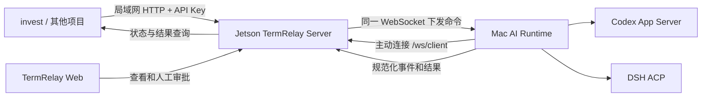

# TermRelay 对外提供 AI 能力的设计方案

> 状态：TermRelay 第一版已实现；部署配置见 [AI_SERVICE_SETUP.md](AI_SERVICE_SETUP.md)。invest 接入待用户确认，见 [INVEST_AI_SERVICE_TODO.md](INVEST_AI_SERVICE_TODO.md)。
>
> 目标：让 `invest` 等项目通过局域网 API 调用 Mac 上的 Codex、DSH 能力。只提供长期会话和一次性会话两种模式，以通用 API Key 鉴权，不绑定项目、设备或用途，不实现会话断线恢复。

## 1. 结论与职责边界

将 TermRelay 扩展为 AI 会话执行服务：Jetson 上的 Server 提供局域网 API，Mac App 沿现有 `/ws/client` 主动连接 Server，接收请求并运行 Agent。外部项目只与 Server 通信。

- Server 管理API Key、任务记录、结果和设备路由。
- Mac 保留模型凭据、本地路径、Agent 进程和工具权限的最终执行权。
- 调用方保留业务编排、事实构造、预算、结果校验和数据库写入。

本方案只覆盖局域网机器调用，不增加公网入口、设备配对或外网调用流程。对 `invest`，先替换模型调用适配器，不迁移整套投资分析业务。

## 2. 两种会话

| 模式 | 典型场景 | 生命周期 | 上下文 |
| --- | --- | --- | --- |
| 长期会话 `conversation` | 一天内持续分析异常行情，跟踪同一问题的变化 | 创建一次，串行提交多轮；业务结束后显式关闭 | 同一 Agent 会话保留前面各轮上下文 |
| 一次性会话 `job` | 一次期权推荐、独立证据审查或策略复核 | 创建独立会话，执行一轮，得到结果后关闭运行时 | 每次请求独立；新推荐创建新会话 |

长期表示允许多轮复用，不表示永久进程或无限记忆。例如 `invest` 在交易日首次异常分析时创建 conversation，后续把新行情和问题提交到该 conversation，收盘后主动关闭；下一个交易日重新创建。一天的范围由 `invest` 管理，TermRelay 不添加交易日调度或空闲自动关闭逻辑。

长期分析每轮仍需携带时间、快照标识和最新事实，并明确哪些数据替代旧数据。已有上下文提供分析连续性，但旧行情不能成为当前事实；上下文容量受 Provider 限制，TermRelay 不承诺完整无限记忆。

一次性 job 不接受后续 turn。多阶段推荐由调用方编排独立 job 并传递材料；需要共享上下文的工作使用长期 conversation，完成后显式关闭。主分析与独立复核使用不同会话。

`invest` 当前通过 `../invest/server/src/invest_server/adapters/llm/openai_compatible.py` 调用 `chat/completions` 获取 JSON，再由业务服务校验 Schema、证据和持仓行动。迁移后这些校验与模型修复仍留在 `invest`；TermRelay 不自动发起修复轮次。

## 3. 通信拓扑与目标选择



```text
Mac App ──主动连接──> ws://JETSON_LAN_IP:3006/ws/client
invest  ──携带 API Key──> http://JETSON_LAN_IP:3006/api/ai/v1/...
Server  ──沿已有 WebSocket 下发──> Mac ──运行 Codex / DSH
```

如果 `invest` 位于另一个 Docker 容器，容器中的 `127.0.0.1` 指向自身，应配置可达的 Jetson 局域网地址或共享 Docker 网络服务名。实际地址和端口由部署配置决定。

### 3.1 固定目标 Mac

每次创建必须指定 `target.deviceId`。Server 不自动选设备或故障转移；会话创建后固定设备、Provider、模型和本机工作目录授权。后续 turn 不允许切换这些配置。设备 ID 使用固定偏好域保存，兼容已有值；首次生成可由本机硬件标识派生，开发与打包启动共用，不随重启或 Server 变化而变化。

第一版只支持 deviceId。后续可增加管理员配置的单设备别名，映射调整只影响新请求。重复提交先查询已有幂等记录，命中时返回原资源；只有新请求才解析当前别名并保存实际 deviceId，避免别名调整改变已有任务。

### 3.2 能力发现

当前 `device.register.tools` 是内置工具列表，不能证明 CLI 已安装或凭据可用。`ai.capabilities` 使用 providers 数组：Mac 连接后及配置变化时上报可用 Provider、容量和 workspaceEnabled，不上报密钥或真实路径。删除业务 Profile 和模型／强度白名单；实际可用模型与强度由 Provider 在启动时验证，列表不保证凭据或模型请求一定成功。

`GET /api/ai/v1/targets` 返回当前服务的设备与已开放 Provider，包含在线状态、名称、容量和工作目录授权状态。Key 不绑定设备或用途；Server 检查实际连接、能力与容量，Mac 再次验证本地执行权限。失败返回 `device_offline`、`device_busy` 或 `capability_unavailable`，不换设备重试。Web 配置页通过独立浏览器管理接口展示这些能力并支持复制固定设备 ID。

## 4. 生命周期与最小状态

后台会话不需要打开新的 Mac 窗口。UI 用于查看、审批和停止。

长期会话只用 `starting`、`ready`、`closed` 三个状态。`ready` 表示运行时已创建且未关闭，是否忙碌由 `activeTurnId` 判断；每轮结束后仍可提交下一轮。一个 conversation 只允许一个活动 turn，并发提交返回 `409 conversation_busy`，不隐式排队。启动失败进入 `closed` 并保存原因。

job 和 turn 共用五个状态：`accepted`、`running`、`succeeded`、`failed`、`cancelled`。审批和用户提问通过 `waitingFor = approval | input | null` 及请求 ID 表示，不增加独立任务状态。`succeeded` 表示该轮正常完成且输出通过声明的通用格式检查，不表示业务结论已经有效。

### 4.1 断线与退出

第一版不实现断线补跑、运行时核对或上下文恢复。设备连接被判定断开、Server 重启、Mac App 或 Agent 退出时，相关外部会话结束；长期 conversation 为 `closed`，未完成的 job／turn 为 `failed`。

错误区分 `connection_lost`、`server_restarted`、`runtime_exited`。对于已可能开始执行但无法确认结果的任务，返回 `executionOutcome = unknown`；这表示服务无法确认结果，不表示工具操作没有发生。调用方自行决定是否创建新请求，不自动重跑。

Mac 检测到与 Server 的连接断开后，停止自己拥有的外部运行时并释放容量；重新连接只接受新会话，不重新公布旧外部会话为可继续。Server 已终止的 job／turn 不接受迟到结果覆盖。关闭和失败处理按稳定资源 ID 幂等，不改变手动会话原有行为。

Server 现有断线／启动结束会话的机制可沿用，并同步关闭 AI 资源记录。现有“未发送用户消息的 ACP 会话清理”必须区分外部会话，不能误删仍开放、尚未提交首轮的 conversation，也不能删除独立 AI 任务／幂等记录。历史用于查看，不用于恢复 Agent 上下文。

### 4.2 启动、容量与超时

创建顺序：Server 鉴权并持久化请求 → Mac 检查 Provider、目录、权限与容量 → 启动运行时和协议握手 → 创建 Provider 会话 → 验证并应用调用方模型配置 → 长期会话进入 `ready`，或一次性 job 提交首轮。失败时关闭已启动的进程，释放容量。

- 第一版没有等待上线或容量释放的任务队列，不可用时立即拒绝。`202` 仅表示已接受并持久化，尚不证明启动或执行成功。
- Server 原子限制设备／Provider 容量，Mac 启动前再次检查。每台 Mac 最多四个外部会话，空闲长期会话也计入运行时总量；失败或结束时释放占用。
- 新会话有统一的启动超时；job／turn 的 `deadlineSeconds` 从接受时起算，覆盖启动、执行、审批等待和结果处理。Mac 也执行该截止时间。
- turn 超时后请求取消，确认停止才结束该轮；长期运行时健康时保持可用，无法确认停止或运行时异常时关闭会话。一次性运行时在所有结束路径清理。
- 取消用 `cancelRequested` 标记；返回 `202` 表示已请求取消，确认停止后为 `cancelled`。若成功结果先提交则保持 `succeeded`；取消期间连接故障则为 `failed`，结果可能未知。
- 设置有界的取消确认超时，超时则停止所属运行时、结束会话并返回 `failed`／`cancel_timeout`，不无限等待。

## 5. 对外 API 与结果契约

所有 `/api/ai/v1/*` 请求携带 `Authorization: Bearer <api-key>`。Key 只做调用鉴权，不识别项目或业务用途，正文无需提交 `projectId`。所有创建及 turn 提交必须携带 `Idempotency-Key`。

### 5.1 一次性会话

```http
POST /api/ai/v1/jobs
Authorization: Bearer <invest-api-key>
Idempotency-Key: <stable-uuid>
Content-Type: application/json

{
  "target": { "deviceId": "<mac-device-uuid>" },
  "provider": "codex",
  "input": {
    "instructions": "根据本次冻结事实生成期权推荐，只返回约定 JSON。",
    "facts": { "snapshotId": "options-20261010-001" }
  },
  "output": {
    "kind": "json",
    "schema": { "type": "object" }
  },
  "contextId": "options-recommendation-001",
  "deadlineSeconds": 180
}
```

```json
{
  "jobId": "…",
  "status": "accepted",
  "deviceId": "<mac-device-uuid>",
  "links": { "self": "/api/ai/v1/jobs/…" }
}
```

- `GET /jobs/{id}`：查询状态、最终结果、错误、实际模型和用量。
- `POST /jobs/{id}/cancel`：幂等请求取消。

以上及下文端点均位于 `/api/ai/v1` 下。`contextId` 只关联业务记录，不复用上下文或替代幂等键。

### 5.2 长期会话

- `POST /conversations`：使用 target、provider、可选 model／effort 和显示名称创建，返回 conversationId、`starting` 和查询链接，不隐式执行首轮。
- `GET /conversations/{id}`：查询状态、activeTurnId 和关闭原因。
- `POST /conversations/{id}/turns`：提交 input、output、deadlineSeconds 与幂等键，返回独立 turnId 和 `accepted`。
- `GET /conversations/{id}/turns/{turnId}`：查询该轮状态和结果。
- `POST /conversations/{id}/turns/{turnId}/cancel`：请求取消当前轮。
- `DELETE /conversations/{id}`：幂等关闭，拒绝后续 turn 并停止所属运行时；连接故障按第 4.1 节处理。
- `GET /targets`：查询服务可用设备和能力。

调用方等待 conversation 为 `ready` 后提交 turn，启动中返回 `409 conversation_not_ready`，失败或已结束返回 `conversation_closed`。后续 turn 不修改目标、目录、Provider 或模型。长期会话空闲时不自动关闭，调用方负责在一天分析或研究结束后关闭。

第一版轮询完成状态和结果闭环。SSE 可后续增加，轮询始终可用；HTTP／SSE 断开不影响任务，不能等同于 Mac 设备断线。

### 5.3 输入、输出和错误

`input.instructions` 是调用方任务指令，`input.facts` 是业务事实，至少一项非空。Mac Adapter 序列化并映射到 Provider，不默认等价于原生 system role。TermRelay 不判断业务用途；本机授权权限始终有效，调用方指令不能覆盖权限，第一版不暴露任意 system／developer 配置覆盖。

`output.kind` 支持 `text` 和 `json`，每轮显式声明。JSON 可携带受限内联 Schema，Server 不建立投资业务 Schema 注册表；保存所用 Schema 内容哈希供审计。限制输入、Schema 和输出大小，拒绝远程 `$ref`，限制嵌套深度和校验复杂度。

Mac 只收集匹配当前 turn 的最终回答，不把思考、工具输出或中间消息拼进结果。JSON 接受纯 JSON 或仅包裹完整 JSON 的单个 Markdown 代码块，不猜测提取多个候选片段；解析失败为 `invalid_json`，Schema 不符为 `schema_mismatch`。TermRelay 不自动调用模型修复，由 `invest` 根据错误和受限长度的原始回答显式发起修复请求。

查询结果包含资源 ID、status、waitingFor、cancelRequested、result、error、actualProvider、actualModel、actualEffort、usage 和耗时。error 含 code、message、executionOutcome；无法确认实际模型或精确用量时返回 `null`，不猜测、不以 `0` 代替未知。业务 Schema、证据有效性和行动校验仍由调用方完成。

### 5.4 最小幂等规则

Server 在下发前原子持久化请求，以 `共享服务范围 + 操作范围 + Idempotency-Key` 建立唯一约束。操作范围含端点类型及父 conversation ID；同键同规范化请求返回原资源，同键不同内容返回 `409 idempotency_conflict`。所有通用 Key 共用范围，调用方使用 UUID 等唯一幂等键；Key 轮换不改变已有记录。旧版项目范围仅保留兼容。

Mac 按稳定的 job／conversation／turn ID 去重。相同命令重复到达返回已有执行状态，不再次启动进程或 turn。ACK 只表示已接收，成功以该轮结束和合法最终结果为准。

Mac 在连接有效时保留未确认结果，直到 Server 确认已持久化；终态写入和取消裁决原子完成。连接断开后按第 4.1 节结束，不补传恢复旧会话。幂等记录保留期不得短于资源查询期，过期请求不再保证去重。

## 6. Mac 运行时与界面

新增 `AIRuntimeManager`，复用 `StructuredAgentAdapter`、`StructuredSessionCoordinator` 和 Codex／DSH Adapter，将启动、容量、本机权限和清理从 UI 流程抽离。后台运行时使用 actor 与 Sendable 边界，UI 状态留在 `@MainActor`。

Server 沿目标设备现有 WebSocket 下发 `ai.session.create`、`ai.turn.start`、`ai.turn.cancel`、`ai.session.close`，Mac 返回规范化 ACK、事件和结果。跨组件消息先写入 `packages/contracts/**/*.schema.json` 再生成 Swift／TypeScript 类型，不修改生成文件；Server 不解析 Provider 原始协议。

模型与强度由调用方指定，不使用业务白名单；省略时采用 Provider 默认值，不继承 UI 上一次选择。当前 Codex 支持模型与推理强度配置，当前 DSH Adapter 未实现任意模型／强度选择，携带不支持参数时明确拒绝。API 结构化启动失败返回错误，不降级为无法满足结果契约的 PTY；手动会话原有 PTY fallback 保留。

### 6.1 项目调用栏目

Mac 侧边栏增加“项目调用”，与手动会话的“当前”和“历史”分开。只列本机 API 创建的外部会话，不识别实际调用项目；通用调用统一标记为 API 来源；长期会话每轮完成显示“等待下一轮”，一次性完成退出活动列表，可在任务历史查询。

创建元数据含 `origin = local | external`、内部兼容字段 projectId（通用调用固定为 api，不代表实际项目）、jobId／conversationId 和 `lifecycle = oneShot | longLived`。传入 Mac ManagedSession 并随 `session.started` 持久化；旧记录缺少 origin 时按 local 兼容。数据库字段用显式 migration 添加，不从名称反推来源。

用户可查看、回复审批／用户问题、停止当前轮和显式关闭长期会话；关闭时提示调用方无法继续使用该 ID。第一版不允许 UI 向外部会话随意插入新 turn，避免改变调用方维护的上下文。Web 按相同 origin 分组，人工审批不能扩大本机权限。

## 7. 工作区与权限

Mac 设置分为连接与交互、AI 服务、工具与凭据三个页签。AI 服务只有开启开关和可选 Codex 工作目录选择器；可执行文件使用文件选择器，凭据使用密码输入框，代理地址使用明确标注的文本框，不要求用户编辑 JSON。

调用方不能传入 Mac 绝对路径。未授权工作目录时创建隔离临时目录；授权目录通过本机文件夹选择器设置，检查规范化路径、存在性与访问权限。Server 只存不透明工作区 ID；目录失效返回错误，不退回用户主目录。长期会话固定创建时的目录与权限快照，撤销目录授权时应先在 UI 或 API 显式关闭相关会话；第一版不提供批量终止活动会话的独立管理接口。

未授权目录时使用 OS 沙箱禁止子进程和普通文件写入，不隔离文件读取或网络访问，不承诺完整数据防泄漏。授权 Codex 目录后使用 workspace-write 和人工审批；DSH 暂不提供工作目录工具。本机权限必须在 Provider、工具处理层或进程隔离层强制执行，不能仅靠提示词。服务不按业务区分分析、推荐或研究，任务和输出由调用方决定。

## 8. API Key 与局域网边界

Web 提供统一 `/settings` 配置页：直接生成通用 Key、复制一次性明文、生成替换 Key、撤销。不需要项目、设备或并发配置，不依赖 Mac 在线。不使用 CLI，后续 Server 配置均扩展到该页。本机路径、模型凭据与执行权限仍留在 Mac。

Key 管理使用独立 `/api/settings/ai` 接口，与配置页一起沿用 Web 现有的 Cloudflare Access 登录保护，允许登录后的浏览器通过 Tunnel 管理；不额外限制局域网来源或拒绝转发请求。保留同源校验并拒绝 AI Bearer Key 管理配置，不增加管理员账号或登录体系。Access 保护范围包含 `/settings` 和 `/api/settings/ai*`，不设置 Bypass；Server 沿用现有 Web 的入口信任方式，不另行验证 Access JWT，绕过 Access 的 Server 端口不得暴露到不可信网络。AI 调用接口的 LAN 限制与此独立。所有新 Key 具有相同 AI API 权限，不区分使用者、项目、设备或用途。

- 使用密码学安全随机源生成至少 256 位随机 Key，完整 Key 仅生成时显示一次。Server 保存 Key 标识、哈希和撤销状态；旧 projectId／grants 字段仅用于兼容，不保存明文。
- `invest` 在忽略提交的环境配置中保存 `TERMRELAY_API_KEY`，每次请求带 Bearer Header。日志不记录 Header 或 Key，Key 不放在 URL、事件或前端资源中。
- 缺少／无效／撤销 Key 返回 `401`；所有通用 Key 可以调用已开放能力、查询和控制 AI 资源，不能把 Key 发给不可信调用方。Key 不扩大 Mac 的本地工具权限。
- 轮换可短期并存两把 Key 再撤销旧 Key；撤销后不接受新 API 操作，已有任务按原生命周期结束。旧版受限 Key 不自动扩大权限，生成替换 Key 后改用通用鉴权。
- API Key 只授权 AI 端点，不赋予普通管理接口、设备注册或浏览器审批权限。Mac 仍用受信 LAN `/ws/client`，设备身份机制不在本方案扩展。

AI API 只允许受信局域网／指定 Docker 网络访问，不映射公网 Tunnel 或公网端口。若现有 Tunnel 转发整个 Server，必须在入口明确阻断 `/api/ai/v1/*`，避免因共用监听端口而对外可达。API Key 提供调用鉴权，不加密 HTTP 传输；当前 HTTP 部署限定在受信网络内。

## 9. `invest` 迁移与数据保留

新增 `TermRelayProvider`，保留 `analyze()`、`complete_json()`、`repair_analysis()` 的业务语义。配置 Server 地址、API Key、固定设备与 Provider。返回类型兼容未知用量，预算不能依赖始终可用的精确 Token 统计；同时记录调用次数、耗时和业务输入哈希。

1. 先验证一次性期权推荐或手动分析：发送冻结事实，查询结果，继续现有 Schema、证据和行动校验；修复由 `invest` 显式提交新请求。
2. 接入一天内长期异常行情分析：业务持久化日期／研究主题与 conversationId 的关系，串行追加最新事实；收盘或用户结束后关闭。旧会话已关闭时，显式创建新会话并提供必要摘要，不自动恢复。
3. 再迁移盘中、收盘、新闻审查和独立复核，按上下文需要选择两种模式，保留调用门控、预算、降级和业务记录。

外部任务独立保留，第一版固定状态、结果和幂等记录保留 30 天，原始输入及详细事件保留 24 小时；可配置保留期留待后续。结果也可能含持仓信息，按敏感业务数据处理；清理覆盖 Server 事件、Mac 缓存、未确认结果和临时目录，不能只删除任务表。活动长期会话不因记录 TTL 被关闭；资源保留期从结束时起算。过期历史查询明确返回不可用，调用方提前保存所需结果。

## 10. 实施阶段与验收

**阶段 1：一次性闭环。** API Key 生成与校验、固定设备／Provider 能力、权限强制、一次性 JSON job、Mac 后台运行、来源元数据与项目调用栏目、状态／结果查询。同步实现持久化、最小两端幂等、容量限制、本地超时、取消和结束清理，不推迟这些基本能力。

**阶段 2：长期闭环。** 创建 conversation、逐轮串行、每轮查询／取消、显式关闭、人工审批、断线即结束。用同一交易日多次行情输入验证上下文连续性和事实更新，完成后迁移自动分析。

**阶段 3：便利性与运维。** 可选 SSE、设备别名、Key 管理体验和保留策略配置；不引入会话恢复、自动故障迁移或等待队列。

验收至少覆盖：

- 无 Key／撤销 Key 无法访问，无需项目／设备即可生成 Key；Mac 未上线也不阻止生成，本地执行权限仍有效。
- 同请求并发重试只创建一个资源，Mac 重复命令不再次执行；Key 轮换不改变服务级幂等记录。
- 一次性完成释放运行时，新推荐上下文独立；长期串行保留上下文，显式关闭后不可继续。
- Mac 断线／退出或 Server 重启结束外部会话；恢复连接不恢复旧会话、重跑旧任务或让迟到结果覆盖终态。
- 超时／取消确实停止当前轮，清理只影响 TermRelay 拥有的进程；结果未知时明确告知调用方。
- 恶意输入不能绕过本机执行权限，JSON 提取和校验失败可由调用方处理。
- 手动与外部会话分栏、审批来源清晰；业务证据校验保留，敏感数据和本地缓存按期清理。
