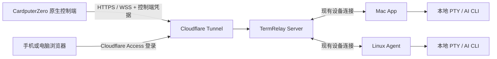

# CardputerZero 原生客户端技术方案

## 1. 状态与结论

- 日期：2026-11-05。
- 状态：技术设计与项目初始化，业务功能尚未实现，未完成实机验证。本文的新增接口、数据表和性能指标都是提案，不代表现有能力。
- 目标：把 TermRelay Web 的远程操作能力带到 CardputerZero，通过公网访问现有 Server，任务继续运行在 Mac / Linux Agent 上。
- 推荐：C++17 + LVGL 原生界面，HTTPS + WSS，独立的控制端配对与可撤销凭据，ARM64 Debian 包。
- 复用 Mac 已开放的同一域名和三个精确路径：`/api/client-pairings`、`/api/client-pairings/token`、`/ws/client-public`，不新增 Cloudflare Bypass 配置。共用公网入口，但执行端与控制端凭据、权限及消息处理严格隔离。
- 首版交付结构化对话、审批、问答、会话浏览和公网授权；完整 PTY 为后续独立里程碑，不宣称首版已与 Web 全功能对齐。
- 已新增设计文档与 `apps/cardputerzero` 模板项目，不修改 Server、Mac、Linux、Web 或 Contracts 的既有行为。

## 2. 已确认依据与待验证条件

### 仓库事实

- Mac 公网配对使用 `/api/client-pairings`、`/api/client-pairings/token`，浏览器通过 `/client/authorize` 和 `/api/client-approvals` 批准。
- `ClientAuthService` 签发 `tr_device_...` opaque credential，Server 只保存 secret 摘要；默认不自动过期，支持撤销。
- `ClientAuthWsAdapter` 在 `/ws/client-public` Upgrade 时校验凭据。该身份是会话执行设备，不是远程控制用户。
- Web 通过 `/api/devices`、`/api/sessions` 等 HTTP API 查询，通过 `/ws/web` 订阅和发送命令。
- Web 的命令使用协议版本 `2`，发送包装为 `{ "event": "message", "data": envelope }`；原生端必须逐项复用实际收发格式，不能把它当 Socket.IO。
- `BrowserGateway` 当前依赖 Access / Tunnel 的部署边界，不在连接时独立验证 Access JWT；不能把它直接改为公网 Bypass。
- 现有 `approvedBy` 是审批审计字段，不构成多租户或设备所有权模型。
- 现有订阅回放面向浏览器，允许较多事件；原生端不能直接继承其内存使用假设。

### 设备与 SDK

- 已查阅的设备报道给出 CM0 Lite、512MB RAM、320×170 LCD、46 键键盘；最终以实机和量产资料为准。
- AppBuilder 当前文档提供 LVGL + CMake 模板、桌面 SDL 预览、设备 framebuffer 构建和 ARM64 `.deb` 工作流。
- 已核对用户提供的本地 Template-main 源码：模板项目版本 0.2.1，C++17、CMake 3.31+、LVGL v9.5.0，桌面实际使用 SDL2。模板有 MIT 许可证；解压包无 Git 元数据，尚不能确定上游 commit。
- 先验证目标系统 ABI、glibc、屏幕方向、输入设备、启动器生命周期、LVGL 版本和字体加载方式，再锁定依赖。
- 不能仅凭 Cortex-A53 支持 64 位就判断镜像一定是 ARM64；若实机为 armhf，必须先确定更换镜像或新增构建目标的策略。
- SDK、模板及依赖固定版本或 commit，保留许可证与来源，不在构建时无条件跟随上游最新分支。

参考：

- [Mac 公网认证](CLOUDFLARE_MAC_CLIENT_AUTH.md)
- [Cloudflare Access 部署](CLOUDFLARE_ACCESS.md)
- [架构](ARCHITECTURE.md)
- [AppBuilder](https://github.com/CardputerZero/AppBuilder)
- [Template](https://github.com/CardputerZero/Template)
- [设备报道，2026-05-25](https://www.cnx-software.com/2026/05/25/cardputerzero-a-raspberry-pi-cm0-pocket-computer-for-makers/)

## 3. 拓扑与角色

CardputerZero 不注册成执行设备，不公布工作区，不持有远端真实路径，不启动远端 Provider 的替代进程。它只有控制端 installation ID，不能用该 ID 替换命令信封中目标 Mac / Linux 的 device ID。

Mac / Linux 继续拥有路径、进程、模型协议解析和最终能力校验。Server 负责认证、资源授权、命令路由和持久化；原生端只解析 TermRelay 公共协议，不解析 Codex / DSH 原始协议。

## 4. 公网授权与首次配对

### 4.1 用户流程

1. 在 CardputerZero 配置服务域名，选择“授权设备”。正式环境仅接受 HTTPS，证书验证失败不得继续。
2. App 发起配对，提交随机 installation ID、设备显示名、App 版本和固定角色 `controller`。这些字段只是标识，不是认证依据。
3. 掌机只显示“等待 Web 授权”，不展示授权码、二维码、链接或倒计时；过期后允许重新申请。
4. 用户自行登录现有 TermRelay Web 页面，通过已有 Cloudflare Access 登录，在“设备授权”中查看待授权客户端。不新增独立扫码批准页面。
5. Web 待授权列表明确显示“远程操作客户端”，与“提供会话的 Mac / Linux 设备”区分；展示设备名、安装 ID 摘要、版本、申请时间和来源信息。用户核对自己发起的申请，选择允许控制的执行设备和权限后批准；不能仅凭可伪造的名称自动批准。
6. App 按服务端间隔轮询。批准后一次性领取控制端凭据，原子保存，清除内存中的临时 device code。
7. App 使用该凭据连接现有 `/ws/client-public`，以控制端身份查询和订阅授权范围内会话。业务查询和操作全部通过该 WSS，不再新增掌机专用 HTTP 业务路径。

不在 CardputerZero 内置登录浏览器，不读取 Cloudflare Cookie，不分发 Cloudflare Service Token，不要求用户在掌机输入长期密钥。新控制端流程不生成 user code 或 verification URL；pairing ID 用于 Web 定位申请，私密 device code 仅由发起申请的掌机持有，不能通过待授权列表查询或用于人工输入。

### 4.2 共用公网入口与 Web 管理接口

公网侧直接复用 Mac 已开放的精确路径，不依赖子路径通配规则。Web 管理接口仍位于现有 Access 保护范围：

| 路径 | 调用方 | 认证与用途 |
| --- | --- | --- |
| `POST /api/client-pairings` | Mac / 掌机 | 复用；掌机显式提交 `role: controller`，创建控制端配对 |
| `POST /api/client-pairings/token` | Mac / 掌机 | 复用；凭 pairing ID + 高熵 device code，按服务端配对记录角色兑换对应凭据 |
| `GET /api/controller-approvals` | 现有 Web | Access 保护；分页列出待授权申请，不返回 secret |
| `POST /api/controller-approvals` | 现有 Web | Access 保护；按 pairing ID 批准或拒绝，并提交授权范围 |
| `/api/controller-credentials` | 浏览器 | Access 保护；查看、缩减权限、撤销 |
| `WSS /ws/client-public` | Mac / 掌机 | 复用；Upgrade 阶段按凭据绑定执行端或控制端角色 |

创建配对未提交 role 时继续按现有 Mac 执行端处理，显式 `controller` 进入新流程，未知 role 拒绝。掌机响应必须明确确认控制端角色；旧 Server 未支持该角色时，掌机提示升级，不降级为 Mac 执行端。token 兑换只以持久化配对记录决定角色，不能由兑换请求临时改变。

取消待授权申请也复用 `/api/client-pairings/token`，增加可选 `action: cancel`，必须携带该申请的私密 device code；未提供 action 时保持既有兑换行为，未知 action 拒绝。取消与批准/兑换并发须原子处理，已消费记录不能因取消而撤销其他身份。

创建配对返回 `pairingId`、私密 `deviceCode`、`expiresIn` 和 `pollInterval`，不返回短码或批准页地址。有效期建议 10 分钟，轮询初始间隔 3 秒，响应带 `pollInterval` / `Retry-After`。支持 pending、denied、expired、consumed、slow_down 等明确状态；批准和兑换在数据库中原子执行，一份配对最多签发一份凭据。待授权列表仅供已登录管理者访问，按状态和时间分页；同一安装限制有效待处理申请数，防止刷屏，但不把安装 ID 当作身份凭证。

凭据建议使用独立前缀 `tr_controller_<id>.<secret>`，secret 至少 256 bit 随机熵。正式控制端凭据永久有效，`expiresAt = null`；服务端验证前缀、摘要、撤销状态和角色，不按时间或闲置时长使其失效。Mac 凭据只能进入执行端处理器，控制端凭据只能进入控制端处理器，不能通过首帧声明切换角色。

凭据响应和待授权列表使用 `Cache-Control: no-store`。兑换响应丢失时不能凭 pairing ID 重新取回 secret；提示重新配对，并在现有 Web 的设备授权管理中撤销孤立凭据。客户端设备名、版本、请求权限和安装 ID 都必须限制长度。

### 4.3 Cloudflare 零新增配置原则

- 沿用当前 Mac 已配置的同一域名、Tunnel 和精确 Bypass：`/api/client-pairings`、`/api/client-pairings/token`、`/ws/client-public`。不新增域名、端口、Access Application 或 Bypass 规则。
- 不把新业务 API 塞到配对接口的子路径下，也不假设父路径的精确规则覆盖子路径；掌机业务通过既有 WSS 连接传输。
- `/api/controller-approvals`、`/api/controller-credentials` 和现有 Web 页面保持 Access 保护，不能包含在 Bypass 中。不新增 `/controller/authorize` 路由。
- 不 Bypass `/api/*`、`/ws/*`、`/ws/web`、`/ws/client`；不扩大现有规则匹配范围。共享入口的控制端限流和连接配额需与执行端隔离，避免掌机请求耗尽 Mac 可用容量。
- 配对和失败鉴权同时使用边缘限流与 Server 限流，限制 IP、pairing 和 credential 维度；只信任可信代理传递的来源地址。
- 源站继续只经 Tunnel 公网可达；浏览器管理面只接受可信 Tunnel 的 Access 身份头。不能把任意客户端自填邮箱头作为身份。
- 批准和撤销 POST 校验 Origin / CSRF 防护，不仅依赖“已登录”。

## 5. 授权范围、数据模型与撤销

### 5.1 显式资源授权

首版沿用个人部署模型，不宣称支持多租户。批准者具有部署管理权限，明确选择允许操作的 Mac / Linux 设备；默认不授权任何设备，不自动包含未来新增设备。

默认权限为：`sessions.read`、`turns.write`、`approvals.resolve`、`user-input.resolve`。后续独立权限为：`sessions.start`、`sessions.stop`、`terminal.read`、`terminal.write`、`terminal.resize`。

不向掌机开放管理其他凭据、删除历史、修改服务器配置、自动审批配置或附件文件管理。首版审批仅暴露 `allowOnce`、`deny`、`cancel`；`allowSession` / `allowPolicy` 不属于默认操作权限。界面隐藏不是权限控制，Server 必须校验具体 decision。

所有列表、详情、历史、待审批、订阅、实时广播和命令都按授权设备过滤。Server 根据 session ID 查出真实 device ID，再核对信封及授权；不能相信客户端提交的目标 ID。访问未授权资源返回不泄露存在性的结果。

授权基于设备范围，不基于显示名称。允许设备下未来创建的会话也可访问，这一点必须在批准页明示。若后续需要工作区或会话级授权，应作为显式范围扩展，不通过本地筛选假装已限制。

### 5.2 建议新增表

| 表 | 核心内容 |
| --- | --- |
| `controller_pairings` | pairing ID、安装 ID、显示名、版本、device code 摘要、状态、批准者、创建/到期/消费时间；来源信息按最小审计需要保留 |
| `controller_pairing_grants` | 批准阶段确定的设备和权限集合，与配对事务绑定 |
| `controller_credentials` | credential ID、安装 ID、secret 摘要、批准者、创建/最后使用/撤销时间；`expires_at` 固定为 NULL，表示无自动过期 |
| `controller_credential_grants` | credential ID、允许 device ID、权限集合及授权版本 |

安装 ID 不是资源执行设备 ID，不指向现有执行设备表。device code 和 secret 不保存明文，不设置 user code 字段。配对创建和兑换需要有效期、尝试次数限制和限流保护；只有已登录的 Web 管理者可批准，只有持有对应 device code 的掌机可兑换。全部使用显式 TypeORM migration，保持 `synchronize: false`。

不改变既有 Mac 表和凭据含义；共享 HTTP 入口按创建时角色分发，兑换时按持久化 pairing ID 定位对应记录，不信任请求重报角色。避免为增加一个角色重写已工作的 Mac 认证流程。只抽取确实共用的随机数、摘要、限流与连接撤销工具，不复制整套业务路由。

### 5.3 生命周期

- 正式控制端凭据永久有效，`expiresAt = null`，仅在用户主动通过 Web 删除授权后撤销。不设置固定期限、闲置过期、定期重新批准、强制定期轮换或 refresh token；Web 显示“永久有效”，不显示到期倒计时。不改变 Mac 当前凭据策略。
- 短期有效期仅用于尚未完成的配对申请，不适用于已签发的正式凭据。配对超时、Web 的 Access 登录态到期、长时间未使用或 Server / 掌机重启，都不能使既有正式授权失效。
- 配对 HTTP 请求分别校验创建限流和兑换 secret；WSS 在共用入口 Upgrade 时验证正式凭据并绑定不可由消息覆盖的角色和授权上下文，不设置控制端凭据过期计时器；后续每条业务消息检查相应权限与资源范围。
- Web 的“删除授权”调用凭据撤销服务，持久化 `revoked_at` 并保留必要审计记录，而不是仅从列表隐藏或直接删除连接索引。掌机不能自行撤销服务端正式授权。
- 撤销事务提交后立即关闭对应活跃 WSS，并阻止在途异步操作在最终路由前越过已撤销状态；下一次 Upgrade 返回 401。
- 同进程维护 credential 到连接索引。首版沿用单 Server 实例部署；将来多副本需跨实例撤销通知和共享限流，未实现前不宣称即时全局撤销。
- 缩减权限关闭连接并要求重新握手；扩大权限需再次浏览器批准，不能由掌机自行申请后自动生效。
- 发送独立的 `controller.authorization-revoked` 控制消息后以 4003 关闭；客户端收到消息、4003 或明确的 401 后清除正式凭据、停止重连。403 表示权限不足，不盲目清除凭据。
- 正常断网、退出或重启不删除凭据；掌机“清除本机凭据”仅清除本地副本，不撤销服务端授权。若要让授权失效，必须由用户在 Web 删除；丢失本地副本后重新配对不能自动撤销旧授权。

## 6. 服务端接口与协议复用

### 6.1 通过既有 WSS 承载业务查询

掌机不再请求新增公网 HTTP 业务接口。建议在 `/ws/client-public` 的控制端消息集中增加 `controller.me.get`、`controller.devices.list`、`controller.sessions.list`、`controller.session.get`、`controller.events.list` 和 `controller.approvals.list`。不提供掌机自撤销正式授权的消息，授权删除仅由现有 Web 管理入口执行。

请求沿用消息信封和唯一 message ID；查询响应通过 relatedMessageId 关联，携带成功结果或明确错误，不借用 command ACK 表示查询结果。连接级查询无目标会话时，其字段要求由新增 Schema 明确；不能借用执行端 device ID 或强行套入现有会话命令。设置超时、最大并发、结果字节上限和连接级限流；查询超时可重新查询，写操作不自动重放。

消息处理器调用现有 Sessions / Devices 业务服务，通过统一的控制端资源策略过滤，不通过内部 HTTP 转调旧 API。me 返回能力、权限、`expiresAt: null` 和协议版本，不返回 secret。现有 Web 的 HTTP 业务 API 完全保持原样。

列表和历史都采用稳定游标与条数、编码后字节数双上限；建议列表每页 20 条、事件每页 50 条、单页目标不超过 128 KiB。真实事件可能大于页面预算，必须提供有授权检查的按需读取路径，不能通过删掉字段冒充完整协议事件。

对单个超大事件给出明确的大事件引用及加载方式，区分“摘要未加载”与完整内容。审批的命令和风险详情不能静默截断；无法完整检查时禁止批准，可拒绝或转到 Web。

### 6.2 WSS 业务面

- 扩展现有 `/ws/client-public` 的 Upgrade 鉴权，在同一路径识别两类正式凭据，检查角色、权限、撤销状态、来源限流和连接数；控制端不检查时间到期，Mac 按原有策略处理。拒绝时返回 HTTP 401 / 429 / 503，不先升级再认证。
- 保持一个共享 Gateway / Upgrade 注册入口，按已认证连接上下文分发到执行端或控制端处理器，不能为相同 path 重复注册两个 Gateway。只有执行端进入现有 DeviceConnectionRegistry；控制端维护独立连接及订阅注册表。
- 保持 Mac 已有注册、事件上报、ACK 和生命周期语义；执行端消息不进入控制端命令路由，控制端消息不进入设备注册及事件上报路径。未知或跨角色消息明确拒绝。
- 抽取 BrowserGateway 中可复用的订阅与命令处理核心，保留原 Web 行为；原生入口注入额外资源授权和低内存预算，不复制 Provider 逻辑。
- 沿用现有信封字段、命令、ACK、会话状态和有序 seq。命令包括 `tool.turn.start`、`tool.turn.interrupt`、`tool.approval.resolve`、`tool.user-input.resolve`，权限不足一律拒绝。
- 新增控制消息、分页同步握手和必要能力字段，必须先定义 JSON Schema，再生成类型；不手工修改 generated 文件。
- C++ 端根据 Schema 实现明确 DTO 和运行时校验，以共享 fixtures 做跨语言契约测试。首版不为此强制增加通用 C++ 代码生成器。
- 认证 Header 只发送到已确认的同源域名，拒绝跨源重定向；不放 URL、子协议、日志或业务首帧。

### 6.3 历史与实时衔接

1. 连接并认证后请求当前会话的同步边界 `S`；服务端建立订阅，暂存 `seq > S` 的事件，并限制缓冲预算。
2. 返回包含自身版本的会话快照与同步边界，按稳定游标分页读取 `seq <= S` 的历史。首次打开默认只读最近窗口，旧内容由用户翻页加载。
3. 客户端应用快照和需要的历史窗口后确认同步完成，服务端顺序补发缓冲事件，再转入实时状态。未读取的旧历史不能被标记成“已逐条消费”，仅表示早于当前快照基线。
4. 断线恢复从最后已连续应用的 seq 补齐；对重复 seq 去重、对缺口补取，不以“收到的最大 seq”跳过缺失事件。
5. 缓冲溢出、回放超限或历史保留不足时，明确返回需要重新同步，重新建立快照边界，不无界攒内存。

快照边界、分页、缺口和状态版本以仓库实际 seq / stateVersion 语义实现并测试；不能假定列表项、状态通知和事件拥有相同含义。实时阶段缓冲最多一个当前会话，待审批列表另行低频查询并在相关事件后刷新。

## 7. 原生 App 实现

### 7.1 技术栈与模块

| 层 | 推荐 |
| --- | --- |
| 界面 | C++17 + 模板兼容的 LVGL 固定版本；SDL 桌面预览 / framebuffer 设备渲染 |
| 网络 | libcurl HTTPS + WSS，使用支持 WebSocket 的固定版本及 OpenSSL / 系统 CA；若目标发行版不支持则一并构建依赖，不手写 WebSocket |
| 数据 | nlohmann/json；有界 DTO、输入长度和结构验证 |
| 本地存储 | SQLite 保存会话摘要、有限历史、草稿和 seq；凭据单独存储 |
| 字体 | FreeType + 支持中文的授权字体，按需字形缓存；不引入二维码依赖 |
| 后续终端 | libvterm 解析 ANSI / VT，LVGL 固定网格绘制；提前检查目标包许可证兼容性 |
| 构建测试 | CMake + CTest；工具链、依赖与测试 fixtures 固定版本 |

libcurl 具体版本、WebSocket API 可用性、TLS 证书链和 SDK 启动行为属于阶段 0 验证项，不能只在 macOS 编译成功就认为设备可用。

模块分为 `ui`、`application`、`transport`、`protocol`、`storage`、`platform`。UI 线程唯一操作 LVGL；网络线程解码并通过有界队列通知 UI，不能跨线程直接修改控件。数据库写入批处理，退出或暂停时安全提交，不对每个 token 写盘。

### 7.2 小屏交互

- 固定 320×170 横屏，单列全屏页面；不用桌面侧栏，也不依赖触摸、悬停或微小图标命中。
- 连接页显示域名、连接状态和授权入口；发起申请后只显示等待 Web 授权状态，支持取消，申请过期后支持重试；取消时使对应待授权申请失效。不展示短码、二维码或倒计时。
- 会话列表显示执行设备、名称、运行状态和待处理数量；详情再显示完整名称，不通过无限缩小字号挤入列表。
- 对话页按消息分页阅读，保留阅读位置；用户离开底部时新消息不抢滚动，通过未读标记提示。
- 编辑器独立全屏，Enter 换行，通过明确的发送命令提交，避免编辑时误发；键位按实机 Fn / 修饰键能力确定。
- 审批页独立全屏，查看完整详情后再确认；焦点默认落在安全操作，批准需要显式二次确认，不能因为新事件重排误触。
- 问答支持单选、多选、自由输入和取消，按协议能力显示；过期请求不允许继续提交。
- 返回键逐层返回，切换会话保留草稿，断网显示只读缓存；断网期间禁止发送，不持久化待执行审批或命令。

中文阅读是基础要求。首版先支持 UTF-8 显示与英文/符号输入；中文输入需要验证系统输入法是否可用于 framebuffer 应用，否则单独实现或集成轻量拼音方案。未完成中文输入前必须明确标注，不把字体显示当成输入能力验收通过。

Markdown 首版只显示安全的文本、列表、代码块和链接标题，不执行 HTML，不在设备内加载任意外部页面。长 URL 和代码支持换行或水平查看。工具输出按需展开，不默认同时实例化所有历史控件。

### 7.3 命令与连接状态

- 连接状态：未授权、配对中、连接中、在线、重连中、权限失效、需要升级。
- 网络失败按带抖动的指数退避重连，建议从 1 秒增长到 30 秒；恢复时重新鉴权与同步，不自动再次打开授权流程。
- 发送时生成 command ID，保留“发送中 / 已确认 / 失败 / 结果未知”，ACK 不等于 AI 轮次完成。
- 超时、进程退出或断线后，不自动重发发消息、审批、终端输入或远程创建；先刷新状态，由用户决定下一步。沿用服务端既有去重，但不宣称网络端到端 exactly-once。
- 心跳使用协议库的 ping/pong 能力，匹配 Server 当前心跳；区分网络断开、服务端异常和认证拒绝。
- 设备休眠/切后台后暂停重绘，恢复时重新同步；仅因本地 App 退出不得停止 Mac 上的任务。

### 7.4 本地安全与预算

凭据保存到应用私有目录，目录 0700、文件 0600、原子替换并防止符号链接覆盖，不进 SQLite、日志或崩溃上传。若系统提供可用 secret service 可改用；不能把“密钥和密文在同一 SD 卡”称为安全加密。

SD 卡离线复制或设备 root 权限仍可能泄露凭据。正式凭据没有自动到期保护，因此依赖最小权限、私有文件权限和 Web 主动删除授权；设备遗失时应及时在 Web 删除对应授权。更换服务器域名不得自动向新域名发送原凭据，但不因此撤销原域名的服务端授权；不关闭 TLS 验证。Wi-Fi 配置优先使用系统设置，不在 App 内重复实现网络管理。

初始预算为待测目标：常态 RSS 不超过 80 MiB、压力峰值不超过 120 MiB；只订阅一个当前会话；内存事件窗口按条数和字节双限额，建议最多 200 条 / 4 MiB；磁盘缓存最多 20 MiB 并按 LRU 清理。单帧输入设置有限上限并与服务端大事件读取机制配套，不能断开后无限重试同一过大帧。

显示刷新与事件解析分离，流式文字合并刷新，目标活跃时不超过 20 FPS，空闲停止主动重绘。中文字体缓存、TLS、JSON、LVGL 和事件队列都计入内存测量；具体启动时间和续航等实机测量后再给结论。

## 8. 与 Web 的功能对应

| 功能 | 首版 | 后续 |
| --- | --- | --- |
| 公网授权、Web 主动删除授权、断线恢复 | 必需；正式凭据永久有效 | 不引入自动过期或强制定期轮换 |
| 设备 / 会话列表、有限历史 | 必需 | 搜索与更多筛选 |
| 结构化对话、停止轮次 | 必需 | 更完整的配置项 |
| 审批、用户问答 | 必需 | 经批准的扩大授权选项 |
| 远程新建会话 | 不在首版 | 复用 session-starts，独立权限和幂等 |
| 完整 PTY | 不在首版 | libvterm、控制键、尺寸与输出回放 |
| 图片 / PDF 附件、文件预览 | 不在首版 | 按现有附件能力逐项设计 |
| 中文显示 | 必需 | 中文输入独立验收 |
| 自动审批、凭据管理、历史删除 | 不开放 | 继续在 Web 管理 |

PTY 阶段保留原始 base64 字节及 UTF-8 跨帧状态，不把终端输出当 Markdown。支持光标、颜色、滚屏、备用屏幕和 Ctrl / Esc / Tab 等控制键。320×170 下按可读字号选择网格；不要承诺固定 80 列。

PTY resize 会影响同一个远端 PTY 的其他观察端。第一版 PTY 默认不主动 resize，保持已有语义；若要增加尺寸控制权或独占租约，须另行评审并得到确认，不能顺带改变 Web / Mac 的尺寸业务规则。不同终端尺寸下的回放与重排要单独验证。

## 9. 代码归属、构建与部署

- 新应用建议放在 `apps/cardputerzero/`，内部包含源码、测试、平台工具链和 `packaging/`。不修改 `apps/linux` 使其兼任控制端。
- 包内 CMake 编译和设备诊断放应用的 `scripts/`；仓库级发布放根 `scripts/build-cardputerzero-release.sh`，入口建议 `release:cardputerzero`。
- 发布产物放根 `dist/termrelay-cardputerzero/`，包括 `.deb`、SHA-256、版本、ABI、依赖与许可证清单。应用包自己的 build 目录不代替发布目录。
- 构建使用锁定的 Linux 交叉编译环境，macOS 只作桌面 SDL 预览；不以桌面截图替代设备 framebuffer 验证。
- 遵循 APPLaunch 的 desktop 入口、图标唯一命名和非 root 运行要求。屏幕/输入访问通过组权限或设备规则解决，不为方便直接把整个 App 设为 root。
- 安装包不含凭据、服务器生产配置或 Access 密钥。先提供私有安装包，未经明确要求不推送代码、不公开 CI、不发布到 AppStore。
- Server 先应用迁移并部署共享入口的角色分流，再安装 App；Cloudflare 继续使用现有 Mac 公网配置，无需新增规则。部署验证必须确认 Mac 原有请求不变，控制端能力缺失时 App 明确报错。
- 回滚不自动撤销正式授权；若需停止控制端访问，由用户先在 Web 删除对应授权，再回滚应用版本。不修改现有 Bypass，避免误断开 Mac。数据库回滚需先备份；未经用户确认，不得通过删表、删记录或迁移清理使既有授权失效。

## 10. 实施阶段与验收

| 阶段 | 交付与退出条件 |
| --- | --- |
| 0：设备验证 | 确认镜像/ABI、SDK、非 root framebuffer/键盘、中文字体、TLS/WSS、SDL 预览、启动器与 `.deb` 安装；给出实测而非假设 |
| 1：公网认证 | Server 共用入口角色分流、控制端配对/凭据/授权表、现有 Web 中的待授权列表及批准/撤销管理、Upgrade 鉴权；不改 Cloudflare，实测跨网络授权与在线撤销 |
| 2：只读闭环 | 授权设备与会话列表、分页历史、快照/实时同步、离线状态；越权与大事件场景通过 |
| 3：交互闭环 | 对话、停止轮次、单次审批、用户问答、未知结果处理；首版可用包与进度记录 |
| 4：扩展能力 | PTY、远程创建、中文输入和附件按独立需求逐项交付，不混入首版验收 |

每阶段先跑最窄检查；跨包修改完成前执行仓库 `pnpm check`，并补跑新增 CMake/CTest、Server 相关测试和 Web build。真实 Provider / 模型请求仅在明确允许的集成验收中执行，不进入普通测试。

必测用例：

- 配对批准/拒绝/取消/过期、兑换并发与响应丢失、轮询限流；仅凭 pairing ID 或安装 ID 不可兑换凭据，Web 列表不泄露 device code。
- 同一 `/ws/client-public` 下，Mac 凭据发送控制端查询/命令失败，控制端凭据注册执行设备/上报事件失败；缺失或无效凭据的 Upgrade 被拒绝，配对 token 请求缺少有效 device code 被拒绝。创建配对是公开限流操作，不错误要求其预先持有正式凭据。
- 使用现有 Mac 的三个精确 Bypass 规则即可完成掌机跨网络配对、WSS 查询、实时订阅与交互，无新增规则；原有 Mac 配对、注册、事件上报和重连通过回归测试。旧 Server 不被误识别为支持控制端，共享入口未知 role/action 和跨角色请求被拒绝。
- 猜测 session ID、篡改 device ID、越权历史/订阅/广播/审批/问答/终端操作均失败；只读凭据不能写命令。
- 现有 Web 的待授权列表和批准/撤销接口未登录不可访问、CSRF 不通过；Tunnel 身份头不能通过公网请求伪造为管理员。同名或重复申请不自动批准，过期或取消的申请不能再批准。
- Web 删除授权后在线连接关闭、在途命令不能越过最终授权检查、离线掌机下次重连失败；仅从 Web 列表隐藏授权不算通过。
- 签发控制端凭据时 `expiresAt = null`；测试时钟推进超过一年、长期闲置、Access 登录态过期、Server / 掌机重启后仍可使用，连接不因凭据计时到期关闭。配对申请仍可超时，但不得影响此前签发的正式凭据。
- 掌机清除本地凭据或重新配对不撤销旧授权；正式授权只能由 Web 删除，掌机自撤销消息被拒绝。
- 所有日志和发布产物不包含凭据、device code 或实际用户会话内容。
- 快照同步期间新事件、乱序/重复/缺口、流式输出压力、历史超限和单事件超大均不漏状态、不无界增长。
- 命令提交后断网或 ACK 丢失显示结果未知，不自动重放；Web 已处理的审批在掌机不能再次生效。
- 320×170 原生像素截图检查文本边界、焦点、长中文、长代码、审批全文和等待授权状态；实体键盘实测，不以桌面模拟完全替代。
- 连续运行与网络反复切换时测 RSS、CPU、帧率、缓存、温度和电池；性能预算未达标明确记录。
- 安装、升级、保留配置、卸载/清理数据策略和旧包回滚通过；原有 Mac 公网授权、Web 和 Linux Agent 无回归。

## 11. 当前进度与开放项

- 已完成：仓库认证和 Web 控制路径的只读核对、SDK 文档调研、本文设计；基于用户提供的本地模板初始化 [CardputerZero 项目](../apps/cardputerzero/README.md)，完成 TermRelay 命名、独立配置/图标和打包资源归属适配。
- 初始化验证：2026-11-05，CMake 预设解析、macOS arm64 Debug 构建与项目内暂存安装检查通过；启动器、图标、配置文件路径一致，默认不安装模板 systemd 服务。未启动 GUI，无界面截图或交互验收。
- 开发指引：已在 [项目 README](../apps/cardputerzero/README.md) 补充新电脑启动步骤、模板初始化复盘及排障，包括依赖、LVGL 离线源码、CMake 缓存、VS Code 编译数据库、安装暂存和发布限制；未因此扩大应用实现范围。
- 已按用户确认简化：用户自行登录现有 Web，在待授权列表中批准掌机；不使用短授权码、二维码、倒计时或独立批准页面。相关接口、数据模型、依赖与验收项已同步调整，尚未实现。
- 已按用户要求复用现有公网配置：掌机只使用 Mac 已开放的三个精确路径，业务查询通过共享 WSS 的控制端消息完成，不新增公网 HTTP 业务路径或 Cloudflare 规则；角色隔离、兼容性与验收要求已同步调整，尚未实现。
- 已按用户要求调整正式凭据：永久有效，仅在用户通过 Web 主动删除授权后撤销；配对申请仍保留短期有效期。已同步数据模型、生命周期、协议、回滚与验收项，尚未实现。
- 未开始：实际授权/会话/聊天等业务实现、数据库迁移、Cloudflare 配置或发布。初始化仅获取当前构建需要的 LVGL v9.5.0 源码，其余宿主机依赖复用已有安装。
- 未验证：CardputerZero 实机、系统 ABI、上游 commit、中文输入、GUI 交互、启动器生命周期、设备交叉编译、`.deb`、性能和续航；模板字体许可清单及 Debian Maintainer 占位值仍需在正式发布前核实。
- 首版默认：公网必需、专用控制端身份、显式执行设备授权、永久凭据且仅由 Web 主动删除授权、结构化交互优先、暂不包含 PTY 和远程创建。
- 实施前需要确认：实机与镜像信息、首版范围是否接受、中文输入是否必须首版交付；这些不影响本方案采用独立控制端授权的结论。