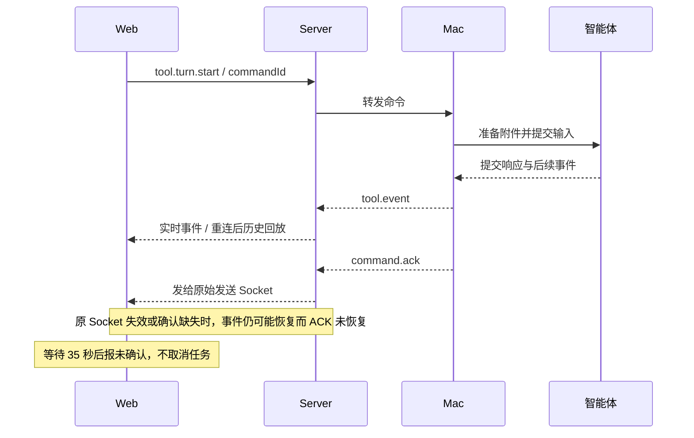

# Web 聊天发送确认异常治理方案

## 1. 状态与结论

- 日期：2026-11-05。
- 状态：核心修复已实现并完成本地回归，尚未部署；未采集生产故障日志。下文故障分析描述修复前的代码，实际落地范围见本节。
- 现象：Web 发送聊天消息后，经常出现“发送结果未确认，请检查聊天记录后再决定是否重发。”，但智能体仍在执行，最终也可能正常完成。
- 已确认：这条提示由 Web 的 35 秒确认计时器触发，不是智能体返回的失败，也不会取消后台任务。
- 已确认的近期变化：2026-11-03 的 `09b207fcf39f3bf4d43de532ac90779cf58c870e` 附件功能提交，首次加入该提示、等待 ACK 的 Promise，以及确认成功后才清空文字和附件的逻辑。
- 尚不能确认：生产环境中每一次缺少确认，是 WebSocket 重连、Mac 确认延迟、部署版本差异、服务端重启，还是其他原因。需要关联日志和受控复现，不能仅凭源码确定发生比例。
- 推荐：保留“没有证据时不自动重发、不清空草稿”的安全规则，增加按命令 ID 的发送状态、事件对账和重连恢复；随后补服务端可查询的持久化提交结果。不以隐藏提示或单纯延长超时作为修复。

### 已落地的修复范围

- Web 按 `commandId` 跟踪等待、待核实、设备已接手、确定未发送四种状态，`protocol.error` 按独立的 `messageId` 关联。35 秒等待结束只转为待核实，不自动重发。
- 以设备最终 `completed` ACK 表示“已交给设备处理”；`accepted` 仍等待最终确认。Provider 返回错误可能存在执行歧义，因此设备 `failed/rejected` 保留待核实状态并展示错误。不将 `user.message`、输出或 running 状态作为提交成功证据：不同运行时发出这些事件的时点不同。
- 复用 `commands` 表，在转发 `tool.turn.start` 前保存全局命令 ID、设备/会话及请求指纹；相同 ID 不再次转发，即使请求内容、会话或命令类型变化。设备 ACK 先保存再通知浏览器；超时或服务重启后的 ACK 也可保存。只保存指纹及确认信息，不保存原文和文件内容。
- 增加 `GET /api/sessions/:sessionId/commands/:commandId`，沿用现有 Web API 访问边界并校验记录所属会话及设备；缺失记录不表示未发送。
- Web 每 5 秒核实最近 10 分钟内未确认的消息；重连、回到前台、手动核实时也查询。浏览器最多保存 128 条、刷新时保留最近 7 天的最小状态元数据。服务端命令记录保留至会话被清理；未实现独立定期清理。数据库关闭时仅使用最多 2048 条内存记录，不能跨服务重启恢复。
- 仅原草稿修订号未变化时，成功确认才清空原文字与附件；迟到确认不清理新编辑的草稿。发送过的附件从草稿移除时不主动删除设备文件，避免干扰尚未确认的执行，由既有附件生命周期清理。再次发送前对未知结果作明确提示，不自动重放原消息。
- 尚未加入设备端持久 ACK 重发机制：若设备 ACK 从未到达服务端，服务端记录继续未知，不能宣称已确认。生产故障比例和链路耗时统计仍待部署后采集。

### 验证与上线

新增迁移：`1793923200000-turn-command-confirmation`。上线时先执行显式数据库迁移，再发布匹配的 Server/Web；无需修改 Mac/Linux 协议。已在本地 `termrelay_dev` 验证迁移、并发去重、关闭连接后恢复及迟到 ACK 持久化；没有使用生产数据库或真实模型请求。

回归覆盖 Web 状态查询补偿、错误关联、超时/迟到/重复确认、跨会话确认隔离、文本与附件草稿清理及新草稿保护。Server 全量测试、Web 测试与构建通过；完整 `pnpm check` 仍被已有的 Mac `testLazyTranscriptKeepsVisibleTextAfterLargeAnswerShrinksWhileReading` 滚动测试阻塞。

## 2. 为什么最近才出现

### 2.1 已确认的代码时间线

| 时间 / 版本 | 实际行为 | 用户感受 |
| --- | --- | --- |
| `09b207f` 之前 | `startToolTurn()` 发送命令，不返回提交结果；聊天组件触发发送后立即清空输入框 | 没有这一条 35 秒未确认提示；缺少可靠的提交成功反馈 |
| 2026-11-03，`09b207f` | 附件功能引入 `pendingTurnCommands`、35 秒等待、最终 ACK 结算；组件等待 `Promise<boolean>`，成功才清理草稿 | 之前不可见的确认缺口，现在会显示警告，并保留文字和附件 |
| 当前代码 | 确认 ACK 与聊天事件分别处理，事件回放不结算发送状态；重连后没有按命令恢复确认结果 | 聊天继续输出与“未确认”可以同时存在，后来成功也可能留下警告 |

历史核对命令：

```sh
git log --all --date=iso --format='%h %ad %s' \
  -S '发送结果未确认' -- apps/web/src/stores/relay.ts
git show 09b207f -- apps/web/src/stores/relay.ts \
  apps/web/src/components/StructuredAgentView.vue \
  apps/mac/Sources/Agents/Core/LocalStructuredAgentSession.swift
```

这次附件改造的目标是避免提交失败后误删草稿，方向合理；新增的确认机制没有同时补齐断线恢复与事件对账，暴露了发送状态闭环的缺口。该等待也应用于纯文字消息，并非只有上传附件才触发。

附件改造还在 Mac 提交前加入附件准备、提交后加入附件保留状态更新。这些步骤可能增加确认链路耗时，尤其是文件处理较重时，但目前没有生产耗时证据，不能直接认定为此次频繁发生的原因。

此次 CardputerZero 开发没有新增 Web 的这条 35 秒逻辑；Git 历史将其引入定位到附件提交。是否恰好在最近部署后开始出现，仍需对照线上实际构建版本，而不是只看本地提交日期。

### 2.2 需要纠正的判断

- 不能把“等待最终命令 ACK”解释成“必须等模型整轮回答完成”。当前 Mac 在 `commandHandler` 返回后 ACK；Copilot / DSH 的 prompt 在后台 Task 中运行，Codex 等待的是 `turn/start` 返回。这是提交确认，不是整轮任务完成确认。
- 收到 `accepted` 只能证明进入接收阶段，不能等同于 Provider 已提交成功，更不能据此删除附件草稿。
- 不能以普通 assistant 输出、会话变为 running，或文本与草稿相同，证明某个具体命令已经成功提交。
- 35 秒是前端兜底，Server 默认 ACK 超时为 15 秒。如果连接正常且默认配置生效，Server 的超时 ACK 通常应先返回；观察到这条特定的 35 秒提示，说明还需检查确认链路或实际部署配置。

## 3. 当前链路与缺口



### 3.1 Web

位置：[发送与计时](../apps/web/src/stores/relay.ts)、[聊天输入框提交](../apps/web/src/components/StructuredAgentView.vue)。

- `pendingTurnCommands` 只记录命令 ID 到布尔结果回调，缺少会话、消息、Socket 代次和独立错误归属。
- `completed` ACK 结算成功；`failed/rejected` 结算失败；`accepted` 不结束等待。
- `session.subscribed` 与 `tool.event` 会恢复聊天，但不会与待确认发送对账。
- Socket close 后重连只恢复订阅，没有提交状态恢复。
- 35 秒到期直接删除待确认项并返回 false，后续成功 ACK 无法再次结算；已有警告也没有按该命令自动消除。
- 通用 `error` 可能混合连接、会话和命令错误；迟到结果不得不加区分地清掉其他真实错误。
- 组件使用 `Promise<boolean>`，把明确失败与结果未知合并；恢复成功后也缺少安全清理原草稿的入口。

### 3.2 Server

位置：[命令转发与 ACK](../apps/server/src/realtime/command-relay.service.ts)、[浏览器订阅](../apps/server/src/realtime/browser.gateway.ts)。

- pending 在内存中保存原始 browser Socket，ACK 不会自动跟随浏览器的新连接。
- `COMMAND_ACK_TIMEOUT_MS` 默认 15000；超时移除 pending，向原 Socket 发送 `failed / ack_timeout`。这只表示缺少 ACK，不能证明设备未执行。
- pending 缺失时，迟到 ACK 被忽略；Server 重启也会丢失这些待确认记录。
- 当前没有供新连接查询的持久化命令提交结果。
- 已有 `markUserMessageIntent()` 仅表示 Server 记录了输入意图，不等于 Mac 或 Provider 已接收，不得用作成功证据。

### 3.3 Mac

位置：[接收命令并确认](../apps/mac/Sources/Remote/RemoteClient.swift)、[本地结构化会话](../apps/mac/Sources/Agents/Core/LocalStructuredAgentSession.swift)。

- 普通聊天命令等待 handler 返回后发送最终 ACK；成功命令在内存中保存有限去重记录。
- ACK 与工具事件独立发布，聊天事件到达不保证最终 ACK 已到达浏览器。
- 去重缓存不是跨进程持久化的幂等保证，不能据此开放自动重发，尤其不能更换 commandId 重发同一请求。

## 4. 推荐状态与证据规则

将“消息提交状态”与“智能体任务执行状态”分开显示与管理。

| 提交状态 | 条件 | 草稿及重发行为 |
| --- | --- | --- |
| 待确认 | Web 已发送，尚无提交成功证据 | 保留发送快照，阻止同一草稿重复提交 |
| 已接收，提交中 | 收到该命令的 accepted | 可显示进度，不清理草稿，不判成功 |
| 已提交 | 收到该命令 completed，或满足严格相关性约束的设备消息事件 | 只清理这一笔发送的原草稿与附件；模型可继续运行 |
| 明确拒绝 | 设备明确拒绝且确认未成功提交 | 保留草稿，显示具体原因，允许用户修改后再次发送 |
| 结果待核实 | 本地超时、ACK 超时、断线或 Server 重启导致结果未知 | 保留草稿，显示核实进度；不自动重发，也不称执行失败 |
| 已恢复确认 | 迟到 ACK、实时事件或历史对账确认已提交 | 转已提交，清除这一笔命令的未确认提示，不影响其他错误 |

`failed` 必须结合 errorCode 分类：`ack_timeout` 是结果未知，不是设备明确拒绝。后台任务失败也不意味着用户消息未提交；不能重新清回已确认的提交状态。

成功证据优先级：

1. 已校验会话、执行设备和 commandId 的 `completed` ACK。
2. 设备发出的 `user.message`，其独立消息 ID 与原 commandId 精确对应，并校验会话、设备及事件来源；实时与历史恢复使用同一对账逻辑。
3. 后续可查询的持久化提交结果，绑定同一设备、会话和命令。

当前 Codex、Copilot、DSH 适配器使用幂等键构造用户消息 ID，但实施前必须逐项验证该 ID 在适配器、归一化事件、Server 持久化和 Web DTO 中完整保留。Codex 的 Provider turnId 不保证等于 commandId，不能混用。

还要验证各适配器的 `user.message` 发出时机：如果仅代表本地接受、尚未确认 Provider 接收，证据最多升级为“已接收”，不能据此宣称“已提交”。契约不满足时，先依赖 ACK，不通过文字匹配降级猜测。

## 5. 分阶段实施

### 第一阶段：Web 提交状态闭环

范围：Web store、聊天输入组件和对应测试。不修改 Provider 逻辑，不新增自动重发。

1. 用按命令维护的结构化记录替代回调 Map，至少保留 commandId、sessionId、deviceId、发送时间、Socket 代次、状态和原草稿版本。发送前注册记录，发送异常要结算并清理计时器。
2. 将 `Promise<boolean>` 调整为区分已提交、明确拒绝与结果未知的结果；超时只解除发送等待，不丢弃后续对账关联。后台记录设置数量和保留期限上限。
3. 用同一函数处理 ACK、实时消息和历史回放的确认；严格校验关联 ID 和作用域，事件重复或乱序不能重复结算。
4. close / reconnect 后将待确认项转为核实状态，恢复对应会话历史；不能只检查当前选中会话。切换会话不得把结果显示到另一会话。
5. 迟到成功只清除该命令的提示；组件只有在会话及草稿版本仍对应原发送时才清空文字，附件按发送时的 ID 集合清理，不能清除用户之后新建的草稿或其他会话附件。
6. 暂无充分事件证据时继续显示“提交结果待核实”，提供查询与明确的人工重发确认，不静默清理、不循环发送。

交付限制：页面关闭或刷新后，若不保存最小待确认元数据，就不能声称支持刷新恢复。第一阶段可选择仅处理同一页面内重连；若持久化，仅保存作用域、命令 ID、状态和必要草稿引用，不新增明文附件内容或凭据存储。

### 第二阶段：Server 可恢复的提交结果

范围：Contracts、Server 显式迁移及测试，必要时补设备确认契约。实施前单独确认跨组件修改范围。

1. 保存有界生命周期的命令提交账本，键为执行设备、会话及 commandId，记录命令类型、必要请求摘要、接收/确认状态和时间；避免复制聊天正文、附件二进制和本地路径。
2. 在发送到设备前持久化待处理状态；合法 ACK 先更新账本，再通知浏览器。超时保留“结果未知”，迟到 ACK 可推进结果，不因原 pending 已清理而丢弃。
3. 提供经现有 Web 身份和资源授权校验的状态查询或订阅恢复接口，匹配命令作用域，不允许跨会话、跨设备探测；新增协议从 JSON Schema 生成，数据库保持 `synchronize: false`。
4. 重连后新 Socket 查询原 commandId；Server 重启后能返回已确认或结果未知。账本中的“曾转发”不等于成功，也不保证设备重启后一定能恢复未知结果。
5. 同一 ID 加不同请求内容明确拒绝。查询结果不能触发再次执行；若需要重发幂等，必须另外验证 Mac / Linux / Provider 的去重生命周期，不把提交账本误称为 exactly-once 保证。

### 第三阶段：设备侧确认时机与可观测性

1. 分别量测附件准备、Provider 提交响应、附件保留更新和 ACK 发出的耗时，确认是否有慢步骤拖延确认。
2. 必要时增加准确的 accepted 阶段反馈；最终 completed 仍代表定义清楚的提交成功，不等模型整轮完成，也不抢在可能失败的必要准备之前发出。
3. 只有在实测证明问题时再调整步骤或超时。不得为了尽快 ACK 跳过附件校验、引用保护或丢失拒绝结果。
4. 普通回归只使用假运行时，不启动真实智能体；需要真实 Provider 的探针必须显式启用。

## 6. 诊断与“近期频发”验证

按同一 commandId 关联以下时间点：

- Web：实际构建版本、会话/设备 ID、Socket 代次、发送时间、open/close、close code、ACK 到达、35 秒触发、关联用户消息到达。
- Server：实际版本、`COMMAND_ACK_TIMEOUT_MS` 生效值、收到命令、记录意图、发给设备、ACK 接收、原 browser Socket 状态、是否发生超时/重启。
- Mac：实际版本、接收、附件准备开始/结束、Provider 提交返回、附件状态更新完成、ACK 发送结果及连接代次。

诊断日志不记录消息正文、附件内容、Cookie、长期凭据或真实本地路径。不为排障读取或输出生产环境文件中的密钥。

判别规则：

| 观察 | 可以支持的判断 |
| --- | --- |
| 发起后发生 Web close，新连接收到聊天回放但原连接 ACK 未到 | 连接切换造成确认与历史恢复脱节 |
| Mac ACK 很晚发出，阶段耗时集中于准备或提交响应 | 设备提交路径延迟，按阶段继续定位 |
| Mac 已发出 ACK，但 Server 未收到 | 检查设备到 Server 连接与发送结果，不能归因 Web |
| Server 15 秒超时已发给旧 Socket，Web 35 秒才提示 | 旧 Socket 确认丢失或重连恢复缺失 |
| 实际 ACK 超时大于 35 秒 | 前后端等待预算不一致；仍需补结果对账，不只改数值 |
| 纯文字也出现 | 排除“必须有附件才触发”，但不能排除共同提交链路问题 |

## 7. 验证与验收

必须有确定性测试覆盖：

1. 正常纯文字与带附件提交，收到 completed 后只清空原草稿一次。
2. accepted 后等待，界面不误报成功、不提前删除附件。
3. 用户消息先到、ACK 后到；反向顺序；重复、乱序以及超过 35 秒的迟到确认。
4. 发出后 Web 断线重连，实时/历史对账能确认原命令；不产生第二次发送。
5. 没有任何成功证据时保持未知；`ack_timeout` 不显示成确定失败。
6. 错误会话、设备或消息 ID 的事件不能确认；同文本的旧消息不能确认新发送。
7. 核实期间切换会话、编辑新草稿、增加新附件，迟到确认不误删或串会话。
8. Server 重启、迟到 ACK 与状态查询，账本阶段结果可恢复；超出账本保留期明确返回未知，不猜成功或自动重发。
9. Mac / Linux 既有命令语义、附件隔离与权限不回归；真实模型长时间回答不被当作提交超时。

迭代执行对应 Web 单测及 `pnpm --filter @termrelay/web build`；跨包改动执行 Server / Mac 或 Linux 对应测试、`pnpm contracts:check` 和 `pnpm check`。浏览器视觉、手机后台切前台、Cloudflare 公网抖动与真实设备作为独立验收，不用合成测试代替。

验收标准：具有可信提交成功证据时，不再保留该命令的未确认警告；确实未知时不伪报成功；不因修复引入自动重复执行、草稿丢失或越权查询。

## 8. 实施顺序与本次交付

- 推荐先补可控复现及最小诊断数据，确认当前生产触发路径；并行准备第一阶段状态模型测试。
- 第一阶段优先修复 Web 误报与对账；第二阶段解决连接和 Server 重启后的确认恢复；第三阶段按测量结果优化设备确认耗时。
- 回滚时保留不自动重发的策略，不能退回“发出即清空”来隐藏问题。账本迁移遵循既有显式迁移流程。
- 方案编写时仅新增本文；当前已实现发送回执、HTTP 状态对账及显式账本迁移。尚未运行生产探针或应用真实数据库迁移，不能把合成测试通过视为公网与真实 MySQL 验收完成。

2026-11-05 合并复核补充：普通消息和手动模型切换统一使用 `sendTurn` 回执入口，收到明确确认后才清空对应输入；删除会话或刷新移除会话时清除对应本地回执，防止失效记录占满待核实额度；并发 ACK 向浏览器返回账本中首个生效的最终结果，保证实时消息与 HTTP 查询一致。

复核验证：Server 196 项通过、4 项跳过，Web 32 项通过，应用构建及原生 2 项 CTest 通过。`pnpm check` 的 Contracts、TypeScript、Linux 检查通过，Mac 仍有此前已复现的聊天滚动空视口断言失败（`testLazyTranscriptKeepsVisibleTextAfterLargeAnswerShrinksWhileReading`），完整 gate 未通过。
